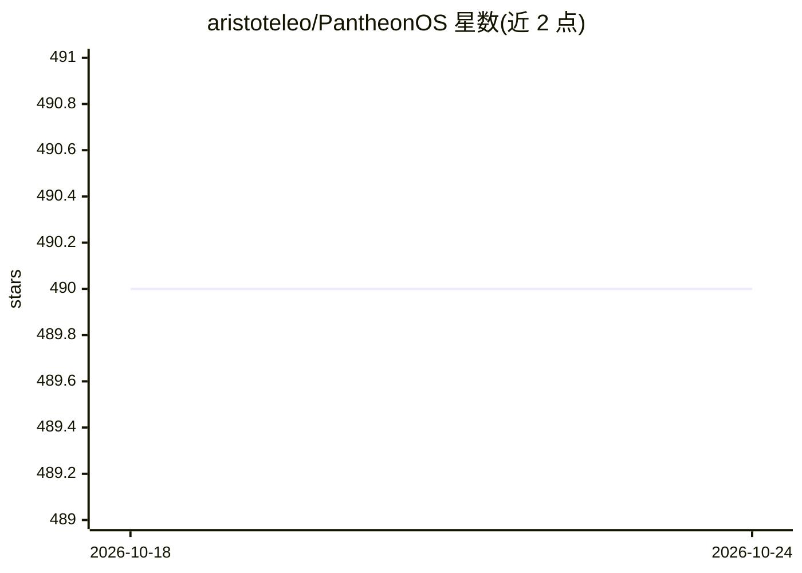

# aristoteleo/PantheonOS

⭐ 490 · Python · BSD-2-Clause · 推送 2026-10-20 · [GitHub](https://github.com/aristoteleo/PantheonOS) · [官网](https://pantheonos.stanford.edu) · 个人维护

**面向数据科学的可进化分布式多智能体框架**

PantheonOS 是用于构建可进化、分布式多智能体系统的 Python 框架，聚焦端到端单细胞生物数据分析。提供 Pantheon-Evolve 模块通过遗传算法驱动的 agentic 代码进化优化算法，支持 Sequential/Swarm/MoA 等多种团队编排模式，基于 NATS 消息实现跨机器分布式部署，并附带 1,000+ 智能体与技能的 Pantheon Store 市场。提供 CLI、Chatroom UI、桌面应用与 Docker 镜像；README 记录了 2026 年 6 月 PyPI 投毒事件及修复说明。

## 筛选速览

| 维度 | 判定 | 备注 |
|---|---|---|
| AI 角色 | `ai-ecosystem` | LLM/agent 周边工具 |
| 许可风险 | `permissive` | BSD-2-Clause |
| 部署形态 | `desktop` | 安装包/桌面程序 |
| 模型依赖 | — | README 未给出锁定关系 |
| 硬件要求 | — | 无带数字的原话,不猜 |
| 安装摩擦 | `low` | 无编译、无系统依赖或容器化 |
| 成熟度 | — | 结构信号不足 |

## 能力要点

- 遗传算法驱动的 agentic 代码进化模块（Pantheon-Evolve）
- NATS 消息分布式架构，Pantheon-Fleet 可控制机器网络
- 多种团队编排模式：Sequential/Swarm/Mixture-of-Agents/AgentAsTool
- Pantheon Store 收录 1,000+ 生物医学智能体与技能

## 适用场景

- 编排多智能体完成单细胞/空间转录组等生物信息分析
- 通过代码进化优化科研算法
- 跨机器分布式部署智能体团队
- 从社区市场安装现成智能体与技能

## 场景标签

`Agent 框架` `多智能体` `科研工具` · 领域:Agent 开发

## 证据(README 行号)

> L23: PantheonOS is an **evolvable and privacy-preserving multi-agent framework** designed to reconcile generality with d
> L27: - **Evolvable** — Pantheon-Evolve module enables agents to improve algorithms and code through genetic-algorithm-dr

## 星数曲线

2026-10-18 490 → 2026-10-24 490（+0）

---
*卡片 v1 · prompt 1.4 · 生成 2026-10-21 · 置信度 high · 依据 README sha `7dc9f245da91` · [字段定义](../../DATASET.md)*
