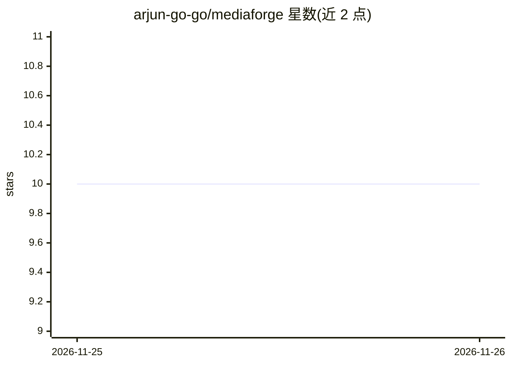

# arjun-go-go/mediaforge

⭐ 10 · Python · MIT · 推送 2026-08-09 · [GitHub](https://github.com/arjun-go-go/mediaforge) · 个人维护 · 中文 README

**面向电商运营团队的 AI 商品图片创作与爆款参考检索平台**

MediaForge 将商品原图、爆款参考检索、平台图片规则、提示词生成、多模型图片生成与质量检查整合为异步工作流，提供商品库、图片创作、任务中心与电商创意助手。检索层支持文本/图像稠密向量与 Milvus BM25 稀疏检索，经 RRF 融合重排；生成流程由 LangGraph 编排，Celery 处理批量任务，任务进度经 SSE 推送。内置淘宝、天猫、京东、拼多多、Amazon 等平台的主图与详情图规则。以 Docker Compose 部署，需 OpenRouter 与 DashScope API Key，依赖第三方图片模型调用并可能产生费用；界面目前以中文电商流程为主，尚未国际化。

## 筛选速览

| 维度 | 判定 | 备注 |
|---|---|---|
| AI 角色 | `ai-native` | 本体是模型或模型工具 |
| 许可风险 | `permissive` | MIT |
| 部署形态 | `self-host` | docker 或自建部署 |
| 模型依赖 | locked-api |  |
| 硬件要求 | — | 无带数字的原话,不猜 |
| 安装摩擦 | `low` | 无编译、无系统依赖或容器化 |
| 成熟度 | `idea` | |

## 能力要点

- 多路爆款参考检索：文本/图像稠密向量 + Milvus BM25 稀疏检索，RRF 融合重排
- LangGraph 编排校验、检索、生成、质量检查、修复流程，Celery 处理批量任务
- 内置国内与跨境平台（淘宝/京东/Amazon 等）主图与详情图提示规则
- 自然语言电商创意助手，对话检索商品并确认后创建生成任务

## 适用场景

- 为电商新品批量生成主图、详情页组图和白底图
- 上传新品图后检索风格相近的爆款参考图辅助创作
- 按目标平台规则自动生成提示词并做质量检查
- 通过对话助手检索商品库并提交生成任务

## 场景标签

`图像生成` `语义搜索` · 领域:内容生成

## 证据(README 行号)

> L3: > 面向电商运营团队的 AI 商品图片创作与爆款参考检索平台。
> L11: MediaForge 将商品原图、爆款参考检索、电商平台图片规则、提示词生成、多模型图片生成和质量检查整合为一套可追踪的异步工作流。项目提供商品库、图片创作、任务中心、工作台和电商创意助手，适合用于搭建企业内部的电商视觉内容生产工
> L11: MediaForge 将商品原图、爆款参考检索、电商平台图片规则、提示词生成、多模型图片生成和质量检查整合为一套可追踪的异步工作流。项目提供商品库、图片创作、任务中心、工作台和电商创意助手，适合用于搭建企业内部的电商视觉内容生产工

## 星数曲线

2026-11-25 10 → 2026-11-26 10（+0）

---
*卡片 v1 · prompt 1.4 · 生成 2026-11-24 · 置信度 high · 依据 README sha `d9b65208c1ad` · [字段定义](../../DATASET.md)*
