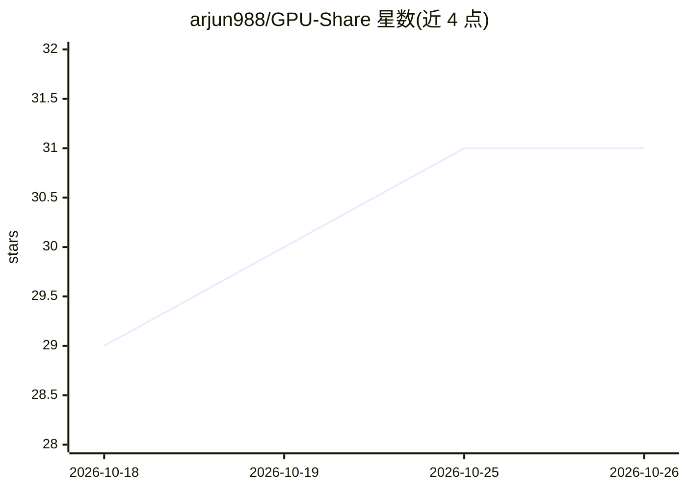

# arjun988/GPU-Share

⭐ 31 · Rust · Apache-2.0 · 推送 2026-09-14 · [GitHub](https://github.com/arjun988/GPU-Share) · [官网](https://gpumesh-architechture.vercel.app/) · 个人维护

**让信任的同伴经 P2P 在你的 NVIDIA GPU 上运行 Docker 任务**

GPUMesh 是一个 Rust 编写的 CLI 优先工具，附带可选本地仪表盘：通过 Ed25519 身份、双向配对与默认拒绝的允许列表，在认证的 QUIC P2P 连接上把 Docker GPU 任务分发到同伴机器执行，无需 SSH/VPN/云。支持打包本地目录远程执行（train.py、Blender 渲染）、组调度（空闲/显存探测）、文件复制、容器内 exec、RDP/VNC 隧道与实验性 CUDA remoting。状态为 Alpha 0.1，CLI 与协议可能变动；macOS 无法共享 NVIDIA GPU。从源码经 cargo 安装。

## 筛选速览

| 维度 | 判定 | 备注 |
|---|---|---|
| AI 角色 | `ai-ecosystem` | LLM/agent 周边工具 |
| 许可风险 | `permissive` | Apache-2.0 |
| 部署形态 | `library` | 以包/库形式分发 |
| 模型依赖 | — | README 未给出锁定关系 |
| 硬件要求 | — | 无带数字的原话,不猜 |
| 安装摩擦 | `medium` | 含编译或系统依赖之一 |
| 成熟度 | `idea` | |

## 能力要点

- Ed25519 身份 + 双向配对 + 默认拒绝允许列表的 P2P 任务执行
- Docker 容器内运行 NVIDIA GPU 任务，支持 VRAM 提示与重试日志
- 组调度：探测成员空闲与剩余显存后选择 GPU
- 本地目录打包上传远程执行，任务后可拉回输出

## 适用场景

- 我想在朋友的闲置 GPU 上跑训练脚本，不想配 SSH 或 VPN
- 小团队组建私有 GPU 集群，按空闲与显存自动调度任务
- 远程渲染或跑 CUDA 程序，并通过浏览器查看 GPU 与任务日志

## 场景标签

`模型训练` · 领域:训练与推理

## 证据(README 行号)

> L5: GPUMesh lets people you trust run Docker GPU jobs on your machine — and lets you run jobs on theirs — over authentic
> L44: - **Docker + NVIDIA** jobs with image, env, workdir, VRAM hints, retries, logs

## 星数曲线

2026-10-18 29 → 2026-10-26 31（+2）

---
*卡片 v1 · prompt 1.4 · 生成 2026-10-26 · 置信度 low · 依据 README sha `ef7ea53713b9` · [字段定义](../../DATASET.md)*
