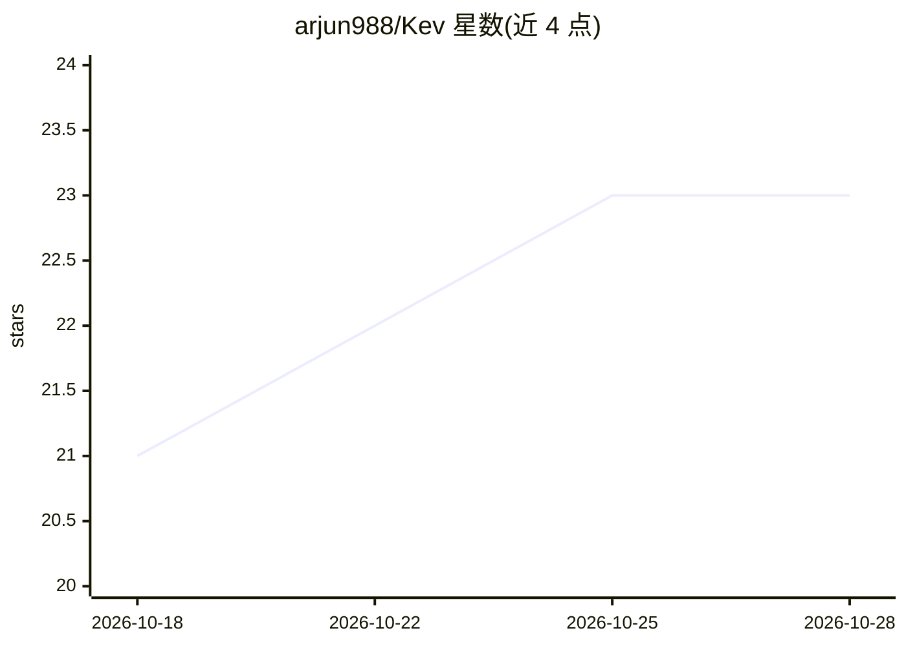

# arjun988/Kev

⭐ 23 · TypeScript · Apache-2.0 · 推送 2026-09-23 · [GitHub](https://github.com/arjun988/Kev) · [官网](https://kev-notjev.vercel.app/) · 个人维护

**自托管的 System One 决策引擎：把 LLM 变成带校准概率的类型化判定 API**

面向开发者的开源决策引擎（Apache-2.0），将 LLM 包装为三个类型化原语：choice（分类标签+分布）、score（有序等级）、noul（[0,1] 概率阈值），应用直接消费数字而非解析文本。自带决策 API 服务器、Playground、CLI 与 MCP server，发布 npm（@kev-ai/sdk/server/cli）与 PyPI 包。后端可插拔：内置 mock（离线 CI）、Ollama 本地模型、任意 OpenAI 兼容端点（vLLM/Groq/Gemini 等）。大选项集自动级联；需 Node 20+ 与 pnpm 9，从源码运行需 clone 后 build。声明与 TypeSafe AI / OpenJev 无隶属关系，提供 Jev 迁移指南。

## 筛选速览

| 维度 | 判定 | 备注 |
|---|---|---|
| AI 角色 | `ai-ecosystem` | LLM/agent 周边工具 |
| 许可风险 | `permissive` | Apache-2.0 |
| 部署形态 | `library` | 以包/库形式分发 |
| 模型依赖 | local-ok | 支持本地模型 |
| 硬件要求 | — | 无带数字的原话,不猜 |
| 安装摩擦 | `low` | 无编译、无系统依赖或容器化 |
| 成熟度 | — | 结构信号不足 |

## 能力要点

- choice/score/noul 三个类型化原语，返回校准概率分布
- 后端可插拔：mock / Ollama / 任意 OpenAI 兼容端点（vLLM、Groq 等）
- 提供 SDK、决策 API 服务器、Playground、CLI、MCP server 与 LangChain/LlamaIndex 适配器
- 公开 held-out 基准（Banking77/CLINC OOS 等）与运维延迟/一致性指标

## 适用场景

- 把 LLM 接入业务系统做意图路由、内容审核或升级判定，直接阈值化概率
- 自托管替代云端决策服务，用自己的本地或云端模型
- 为 Agent 框架提供 MCP 工具化的判定能力

## 场景标签

 · 领域:LLM 基础设施/决策服务

## 证据(README 行号)

> L83: NotJev : Kev turns an LLM into a **typed classifier / gate / scorer** your app can trust:
> L117: NotJev : Kev is the open control plane. The intelligence is whatever model you point it at.

## 星数曲线

2026-10-18 21 → 2026-10-28 23（+2）

---
*卡片 v1 · prompt 1.4 · 生成 2026-10-27 · 置信度 high · 依据 README sha `e0745cfb404e` · [字段定义](../../DATASET.md)*
