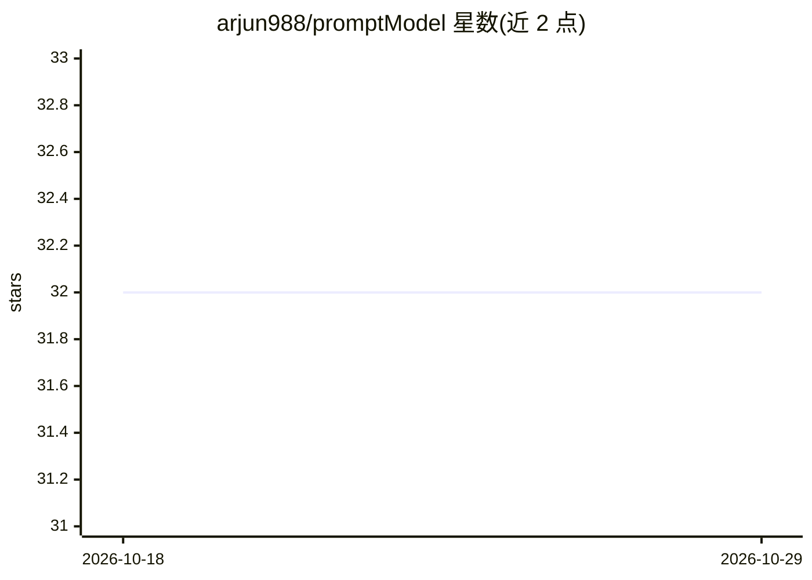

# arjun988/promptModel

⭐ 32 · Jupyter Notebook · MIT · 推送 2026-08-30 · [GitHub](https://github.com/arjun988/promptModel) · 个人维护

**本地提示词质量评分与重写工具，七维度打分并优化弱提示词**

PromptForge（PyPI 包名 tuneprompt）对 LLM 提示词从清晰度、具体性、上下文、目标、约束、完整性、可执行性七个维度评分，然后用优化器将弱提示词重写为保留原意图的清晰指令。评分器基于 ModernBERT-base（约150M，全量微调），优化器基于 Qwen2.5-1.5B-Instruct（LoRA 微调）；权重不存于 git，需从 Hugging Face 下载。总参数约 1.65B，训练可在 8GB GPU 上进行，推理无需 API key。提供 Python API、CLI、Gradio 演示与 Colab notebook，也开放训练脚本供自建模型。

## 筛选速览

| 维度 | 判定 | 备注 |
|---|---|---|
| AI 角色 | `ai-native` | 本体是模型或模型工具 |
| 许可风险 | `permissive` | MIT |
| 部署形态 | `desktop` | 安装包/桌面程序 |
| 模型依赖 | — | README 未给出锁定关系 |
| 硬件要求 | — | 无带数字的原话,不猜 |
| 安装摩擦 | `medium` | 含编译或系统依赖之一 |
| 成熟度 | — | 结构信号不足 |

## 能力要点

- 七维度提示词质量评分（ModernBERT 评分器）
- 意图保持的提示词重写（Qwen2.5-1.5B LoRA 优化器）
- 本地运行，推理无需 API key
- 提供 CLI、Python API、Gradio 演示与训练脚本

## 适用场景

- 对编写好的提示词做质量评分与诊断
- 将模糊的提示词自动重写为清晰、保留意图的指令
- 用自己的数据在 8GB GPU 上重新训练评分器与优化器

## 场景标签

`提示工程` · 领域:Agent 开发

## 证据(README 行号)

> L7: PromptForge scores LLM prompts across seven quality dimensions, then rewrites weak prompts into clear, intent-preser
> L24: |**Multi-dimension scoring**|Clarity, specificity, context, goals, constraints, completeness, actionability|
> L55: |**Scorer**|`ModernBERT-base`|~150M|Full fine-tune|
> L56: |**Optimizer**|`Qwen2.5-1.5B-Instruct`|1.5B|LoRA (base frozen)|

## 星数曲线

2026-10-18 32 → 2026-10-29 32（+0）

---
*卡片 v1 · prompt 1.4 · 生成 2026-10-26 · 置信度 high · 依据 README sha `e2b4fe6c9d20` · [字段定义](../../DATASET.md)*
