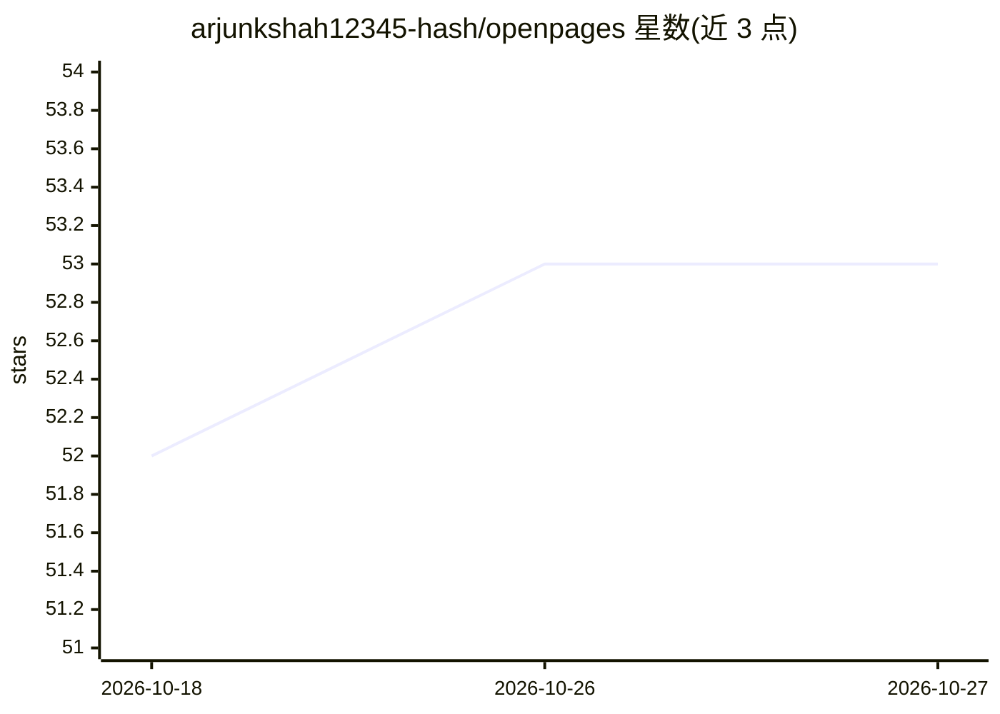

# arjunkshah12345-hash/openpages

⭐ 53 · TypeScript · MIT · 推送 2026-10-01 · [GitHub](https://github.com/arjunkshah12345-hash/openpages) · [官网](https://openpages-iota.vercel.app) · 个人维护

**带上下文压缩层的开源 AI 工作区（Spaces/Pages/agents）**

基于 Next.js/TypeScript 的自托管 AI 工作区：提供多 Space 工作区、Tiptap 块编辑器 Pages、行内 AI 改写、带引用的工作区问答 Agent、多步目标 Agent 模式与 MCP 接口（Cursor/Claude Code/Codex 可搜索读写）。核心机制是 SuperCompress：每轮对话先检索候选上下文，再按查询压缩（托管 API 或本地离线替代），最后交由用户选择的模型推理，Context inspector 显示压缩前后 token。默认 SQLite 存储，附 Docker Compose；需自备 SuperCompress key 与至少一个模型连接，无模型时仅返回演示回复。定位为 OpenAI Pages / ChatGPT Space 的开源替代。

## 筛选速览

| 维度 | 判定 | 备注 |
|---|---|---|
| AI 角色 | `ai-native` | 本体是模型或模型工具 |
| 许可风险 | `permissive` | MIT |
| 部署形态 | `self-host` | docker 或自建部署 |
| 模型依赖 | local-ok | 支持本地模型 |
| 硬件要求 | — | 无带数字的原话,不猜 |
| 安装摩擦 | `low` | 无编译、无系统依赖或容器化 |
| 成熟度 | — | 结构信号不足 |

## 能力要点

- 检索→SuperCompress 查询感知压缩→推理的流水线，附 Context inspector 展示 token 节省
- 模型无关：OpenAI/Anthropic/Gemini/OpenRouter/Groq/Ollama 等可自选，支持 ChatGPT 账号免 API key 登录
- MCP 服务端暴露 space_search/page_create/workspace_context 等工具供 Cursor/Claude Code/Codex 调用
- 版本历史带 user/agent/mcp 归因与恢复；默认 SQLite、Docker Compose 自托管

## 适用场景

- 自托管一个带持久 Space 和协作页面的 AI 工作区，控制 token 成本
- 让 Cursor/Claude Code 等 MCP 客户端读写我的工作区并拉取压缩上下文
- 在长对话/大工作区中查看检索与压缩来源及节省明细

## 场景标签

`知识库管理` `文档问答` · 领域:知识与检索

## 证据(README 行号)

> L8:  Open-source AI workspace with persistent Spaces, collaborative pages,
> L40: OpenPages is a real product (Spaces, Pages, agents, MCP) and a living demo of SuperCompress: query-aware context co
> L70: - **Model agnostic** — ChatGPT account (no API key), OpenAI, Anthropic, Gemini, OpenRouter, Groq, Mistral, DeepSeek

## 星数曲线

2026-10-18 52 → 2026-10-27 53（+1）

---
*卡片 v1 · prompt 1.4 · 生成 2026-10-24 · 置信度 high · 依据 README sha `c31b0970c7b5` · [字段定义](../../DATASET.md)*
