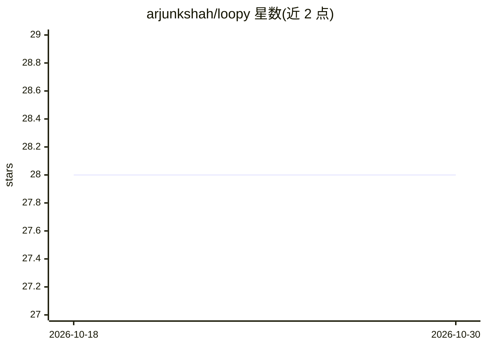

# arjunkshah/loopy

⭐ 28 · Python · MIT · 推送 2026-07-09 · [GitHub](https://github.com/arjunkshah/loopy) · [官网](https://loopy.yachts) · 个人维护

**本地优先的 agent 操作系统：编排 43 个编码代理 CLI 自主完成开发**

面向软件团队的开源 MIT 工具，把产品想法放入工作流后，由其编排的编码代理 CLI（Codex、Claude Code、Cursor 等 43 个）执行调研（Tavily/Firecrawl）、规划（Nebius）、编码、测试与 GitHub/Linear 同步，循环直至完成或预算耗尽，并输出 Ship Receipt。支持 200 轮预算、约 9 小时无人值守运行、最多 10 个并发项目、双代理并行与手动接管。记忆层（mem0/supermemory）可插拔，自动失败关闭。运行在本机、使用用户自己的 API key。

## 筛选速览

| 维度 | 判定 | 备注 |
|---|---|---|
| AI 角色 | `ai-ecosystem` | LLM/agent 周边工具 |
| 许可风险 | `permissive` | MIT |
| 部署形态 | `None` |  |
| 模型依赖 | — | README 未给出锁定关系 |
| 硬件要求 | — | 无带数字的原话,不猜 |
| 安装摩擦 | `low` | 无编译、无系统依赖或容器化 |
| 成熟度 | — | 结构信号不足 |

## 能力要点

- 编排 43 个本地编码代理 CLI，认证留在本机
- 200 轮默认预算，约 9 小时无人值守运行与夜间队列
- 记忆层可插拔（mem0/supermemory），故障时失败关闭
- 自动创建 loopy/<slug> 安全分支，可随时手动接管注入转向指令

## 适用场景

- 给一个产品想法，让代理舰队自主调研、规划并构建直至交付
- 在现有仓库上以变更请求方式自动修 bug 或加功能
- 夜间排队构建多个项目并通过 Gmail 接收每轮进度

## 场景标签

`编码 Agent` `Agent 框架` · 领域:Agent 开发

## 证据(README 行号)

> L3: > **Loopy is a free, open-source, local-first AI coding tool** — an *agent operating system* for software teams. Put
> L11: Loopy is a local agent company on your laptop. You give it a product idea — it researches the market, plans the bui
> L229: Loopy orchestrates terminal-native coding agents — not a hosted runtime. Bring whatever CLI you already use:

## 星数曲线

2026-10-18 28 → 2026-10-30 28（+0）

---
*卡片 v1 · prompt 1.4 · 生成 2026-10-26 · 置信度 high · 依据 README sha `a3edd6aad1b0` · [字段定义](../../DATASET.md)*
