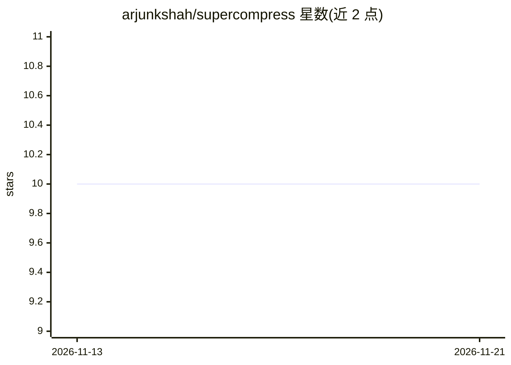

# arjunkshah/supercompress

⭐ 10 · HTML · NOASSERTION · 推送 2026-07-18 · [GitHub](https://github.com/arjunkshah/supercompress) · [官网](https://supercompress.dev) · 个人维护

**为生产 LLM 应用压缩上下文的查询感知提示编译层**

位于应用与 LLM 之间的中间层：接收长上下文与当前用户查询，按块切分、识别内容类型（文本/代码/JSON/日志），对块按查询相关性打分后保留高价值信息、移除冗余，返回更小的 prompt 与 token 节省元数据。查询本身不压缩。提供三种模式（compiler/fixed/precision），CCR 标记支持事后找回被删块；以 Python 客户端调用托管 API 或直接 REST 请求，提供 OpenAI SDK、RAG、Agent State、Vercel AI SDK 集成示例。

## 筛选速览

| 维度 | 判定 | 备注 |
|---|---|---|
| AI 角色 | `ai-ecosystem` | LLM/agent 周边工具 |
| 许可风险 | `none` | NOASSERTION |
| 部署形态 | `library` | 以包/库形式分发 |
| 模型依赖 | — | README 未给出锁定关系 |
| 硬件要求 | — | 无带数字的原话,不猜 |
| 安装摩擦 | `low` | 无编译、无系统依赖或容器化 |
| 成熟度 | — | 结构信号不足 |

## 能力要点

- 按内容类型路由不同预处理器（JSON/代码/日志/文本各自移除项不同）
- 查询永不压缩，仅压缩周边上下文，输出 token 与风险评估元数据
- CCR 可逆压缩：被删块以标记表示并可按 hash 取回原文
- 提供 OpenAI Python SDK、RAG 管线、Agent 状态与 Vercel AI SDK 集成示例

## 适用场景

- RAG 管线送入长检索片段时降低输入 token 成本
- agent 框架状态与工具输出持续增长时压缩历史
- 客服/销售聊天历史送入 LLM 前做压缩
- 审计敏感场景需可找回被压缩掉的原文块

## 场景标签

`RAG` · 领域:知识与检索

## 证据(README 行号)

> L5: SuperCompress sits between your application and the LLM. It takes a long context plus the current user query, remove
> L18: SuperCompress compiles that input before it reaches the model:

## 星数曲线

2026-11-13 10 → 2026-11-21 10（+0）

---
*卡片 v1 · prompt 1.4 · 生成 2026-11-20 · 置信度 high · 依据 README sha `1fd9f3f5e592` · [字段定义](../../DATASET.md)*
