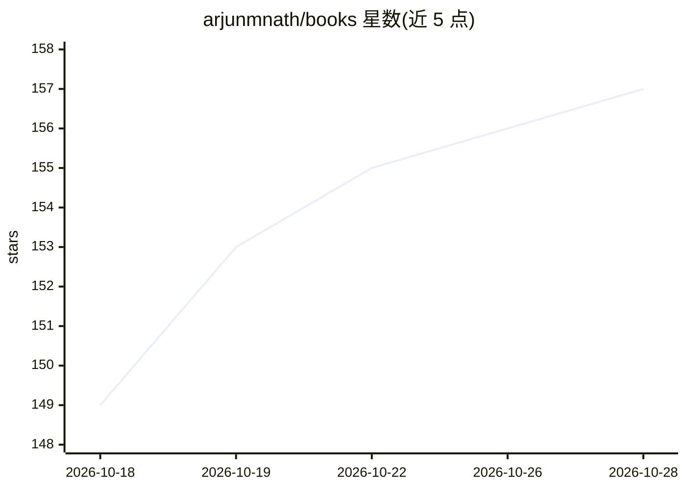

# arjunmnath/books

⭐ 157 · Unlicense · 推送 2026-07-22 · [GitHub](https://github.com/arjunmnath/books) · 个人维护

**计算机/AI/神经科学等领域教材与参考书 PDF 汇总清单**

个人维护的书籍资源清单：按核心计算机科学、电子学、DSA、数据科学、AI/ML、深度学习、LLM、机器人、Linux、工程数学、性能工程、底层硬件、认知科学与计算神经科学等类别收录教材与参考书条目，含书名、版次与作者，部分条目以星标标注。清单仅列书名，README 未提供下载链接或安装运行方式。

## 筛选速览

| 维度 | 判定 | 备注 |
|---|---|---|
| AI 角色 | `ai-knowledge` | 知识聚合/清单类 |
| 许可风险 | `permissive` | Unlicense |
| 部署形态 | `None` |  |
| 模型依赖 | — | README 未给出锁定关系 |
| 硬件要求 | — | 无带数字的原话,不猜 |
| 安装摩擦 | `medium` | 含编译或系统依赖之一 |
| 成熟度 | — | 结构信号不足 |

## 能力要点

- 覆盖 17 个以上类别的教材与参考书条目
- 含 AI/ML、深度学习、LLM 专门章节
- 收录认知科学与计算神经科学书目

## 适用场景

- 查找 AI/ML 与深度学习方向的经典教材
- 按类别浏览计算机与电子学基础书籍
- 了解计算神经科学入门书目

## 场景标签

`精选清单` · 领域:学习与行业

## 证据(README 行号)

> L34: ## AI/ML
> L67: ### LLMs
> L120: ## Cognitive Science

## 星数曲线

2026-10-18 149 → 2026-10-28 157（+8）

---
*卡片 v1 · prompt 1.4 · 生成 2026-10-22 · 置信度 high · 依据 README sha `3bc0dfb231fe` · [字段定义](../../DATASET.md)*
