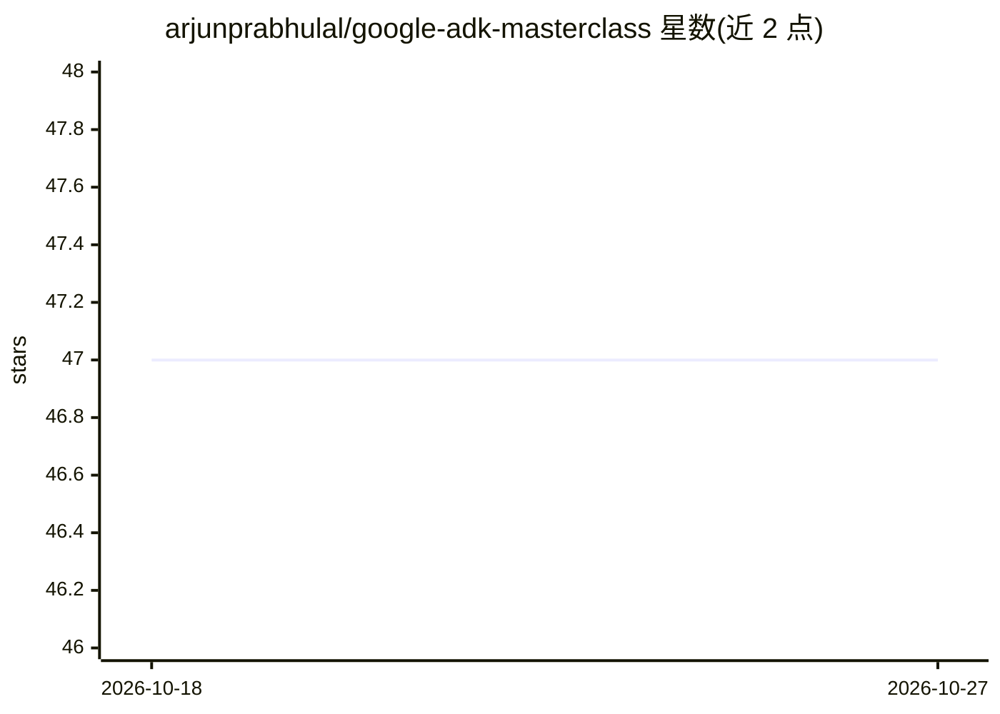

# arjunprabhulal/google-adk-masterclass

⭐ 47 · Python · MIT · 推送 2025-12-08 · [GitHub](https://github.com/arjunprabhulal/google-adk-masterclass) · [官网](https://arjunprabhulal.com/courses/adk-masterclass-hands-on-series/) · 个人维护

**Google ADK 教学：20 个模块带你上手构建 AI agent**

面向学习者的 Google Agent Development Kit (ADK) 实战课程仓库，共 20 个模块，从环境搭建、Agent 类型（LLM Agent、Workflow Agent、多 Agent 系统）、工具集成（内置工具、自定义函数、OpenAPI、MCP、MCP Toolbox）讲到会话/状态/内存、回调、Artifacts、Events 等核心组件。每个模块配分步教程与可运行代码示例，支持 CLI、Web UI 与编程式三种使用方式。前置要求为 Python 3.10+ 与 Gemini API key，Vertex AI 相关模块需 GCP 配置。提供 uv 或 pip 安装方式，MIT 许可。

## 筛选速览

| 维度 | 判定 | 备注 |
|---|---|---|
| AI 角色 | `ai-knowledge` | 知识聚合/清单类 |
| 许可风险 | `permissive` | MIT |
| 部署形态 | `None` |  |
| 模型依赖 | — | README 未给出锁定关系 |
| 硬件要求 | — | 无带数字的原话,不猜 |
| 安装摩擦 | `low` | 无编译、无系统依赖或容器化 |
| 成熟度 | — | 结构信号不足 |

## 能力要点

- 20 个模块覆盖从基础到多 Agent、内存管理的完整课程
- 模块化可运行代码示例，支持 CLI/Web/编程三种接口
- 涵盖工具集成（内置工具、OpenAPI、MCP、MCP Toolbox）与生产模式（状态、回调、事件流）

## 适用场景

- 新手按模块顺序系统学习 Google ADK
- 从 LangChain/CrewAI 迁移者了解 ADK 特有模式
- 构建生产系统的开发者参考状态管理与事件流模式

## 场景标签

`教程课程` · 领域:学习与行业

## 证据(README 行号)

> L16: Build production-ready AI agents with Google's Agent Development Kit (ADK). This hands-on masterclass covers everyt
> L20: - 📚 Step-by-step tutorials progressing from fundamentals to advanced techniques

## 星数曲线

2026-10-18 47 → 2026-10-27 47（+0）

---
*卡片 v1 · prompt 1.4 · 生成 2026-10-25 · 置信度 high · 依据 README sha `bbb72a728f55` · [字段定义](../../DATASET.md)*
