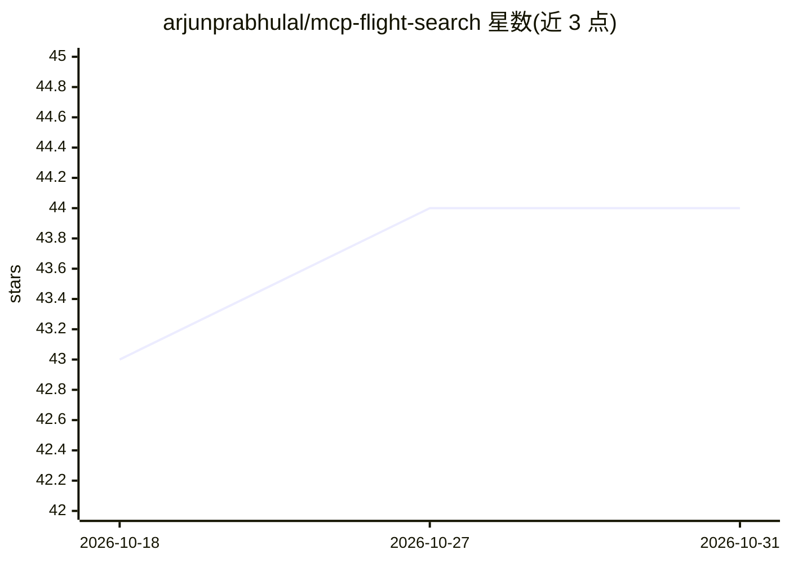

# arjunprabhulal/mcp-flight-search

⭐ 44 · Python · MIT · 推送 2026-10-29 · [GitHub](https://github.com/arjunprabhulal/mcp-flight-search) · [官网](https://pypi.org/project/mcp-flight-search/) · 个人维护

**供 Claude/Cursor 等 MCP 客户端调用的实时机票搜索服务器**

基于 Model Context Protocol 的服务器，通过 SerpApi 的 Google Flights 接口提供机票搜索工具：单程/往返查询，按 IATA 机场代码与日期参数，返回航司、价格（USD）、时长、中转次数、起降时间与舱位等结构化结果。面向使用 MCP 客户端（Claude Desktop、Claude Code、Cursor 等）的用户，配置 JSON 或 pip 安装即可接入；需自备 SerpApi key（有免费层）。支持 stdio 与 Streamable HTTP 两种连接方式，另提供 Docker 构建运行。

## 筛选速览

| 维度 | 判定 | 备注 |
|---|---|---|
| AI 角色 | `ai-ecosystem` | LLM/agent 周边工具 |
| 许可风险 | `permissive` | MIT |
| 部署形态 | `self-host` | docker 或自建部署 |
| 模型依赖 | — | README 未给出锁定关系 |
| 硬件要求 | — | 无带数字的原话,不猜 |
| 安装摩擦 | `low` | 无编译、无系统依赖或容器化 |
| 成熟度 | — | 结构信号不足 |

## 能力要点

- search_flights_tool：按 IATA 代码与日期查询单程/往返航班，返回结构化结果
- 支持 stdio 与 Streamable HTTP（--connection_type http）两种运行方式
- pip 安装或 Docker 构建，可直接写入 MCP 客户端配置
- LOG_LEVEL 控制日志级别，API key 不写入日志

## 适用场景

- 在 Claude Desktop / Cursor 等客户端中对话式查询机票
- 为 AI 助手接入实时航班价格与时刻信息
- 以 HTTP 模式自建机票查询 MCP 服务

## 场景标签

 · 领域:AI 工具集成/旅行信息

## 证据(README 行号)

> L3: An MCP server that searches Google Flights through SerpApi, for Claude, Cursor and other MCP clients. One-way and ro
> L15: Add it to your client's MCP configuration (Claude Desktop, Claude Code, Cursor, ...):

## 星数曲线

2026-10-18 43 → 2026-10-31 44（+1）

---
*卡片 v1 · prompt 1.4 · 生成 2026-10-25 · 置信度 high · 依据 README sha `163b206a5fe8` · [字段定义](../../DATASET.md)*
