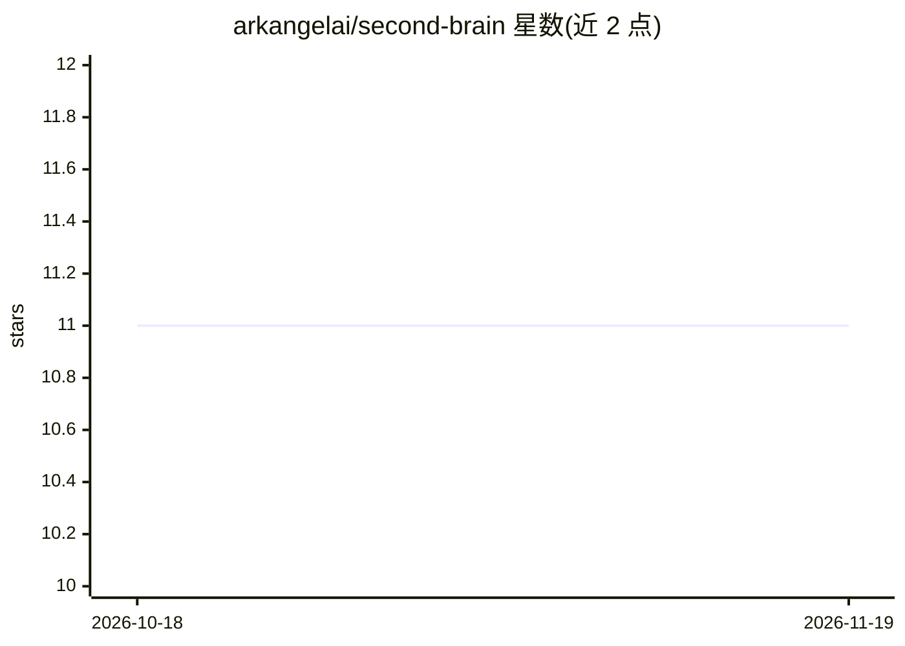

# arkangelai/second-brain

⭐ — · [GitHub]() · 个人维护

**本地优先的个人知识库：Markdown + 本地混合检索 + AI agent 读写**

将 Markdown 笔记库组织为可被 AI agent 主动查询的知识库：QMD 提供 BM25+向量+重排序的 100% 本地混合检索，Obsidian 用于阅读与导航，CLI 负责初始化、检索、笔记脚手架与草稿生成。vault 内置 4 个 agent 无关的提示文件命令（/answer、/research、/resource、/therapy 等），任何 CLI agent 都可读取执行；Obsidian 侧边栏插件嵌入 Claude Code 终端并支持多后端切换。搜索零云依赖；首次 init 需下载约 2GB 本地模型；草稿走 gateway 时需配置 API key。

## 筛选速览

| 维度 | 判定 | 备注 |
|---|---|---|
| AI 角色 | `ai-native` | 本体是模型或模型工具 |
| 许可风险 | `none` | — |
| 部署形态 | `None` |  |
| 模型依赖 | — | README 未给出锁定关系 |
| 硬件要求 | — | 无带数字的原话,不猜 |
| 安装摩擦 | `low` | 无编译、无系统依赖或容器化 |
| 成熟度 | `idea` | |

## 能力要点

- QMD 本地混合检索（BM25+向量+重排序），搜索无云依赖
- vault 内置 agent 无关命令提示文件，Claude Code 自动获得斜杠命令
- Claude Sidebar 在 Obsidian 内嵌终端，支持 Claude Code/Codex/OpenCode/Gemini CLI 多后端
- Notion 发布/回拉流水线：本地草稿发布并回写指标

## 适用场景

- 把分散的文章、视频、论文导入为带 wiki 链接的结构化笔记
- 仅基于自己笔记内容向 AI 提问并获取引用
- 结合语音画像与库内素材生成内容草稿
- 将成品草稿发布到 Notion 并拉回数据指标

## 场景标签

`知识库管理` `科研工具` · 领域:知识与检索

## 证据(README 行号)

> L3: A local-first, AI-native knowledge management system. Markdown files + semantic search + any AI agent.
> L11: Most "second brain" setups are passive filing cabinets. This one is designed to be **actively queried by AI agents*
> L19: |**Search**|QMD|BM25 + vector + reranking — 100% local|

## 星数曲线

2026-10-18 11 → 2026-11-19 11（+0）

---
*卡片 v1 · prompt 1.4 · 生成 2026-11-18 · 置信度 high · 依据 README sha `874910ff4ddf` · [字段定义](../../DATASET.md)*
