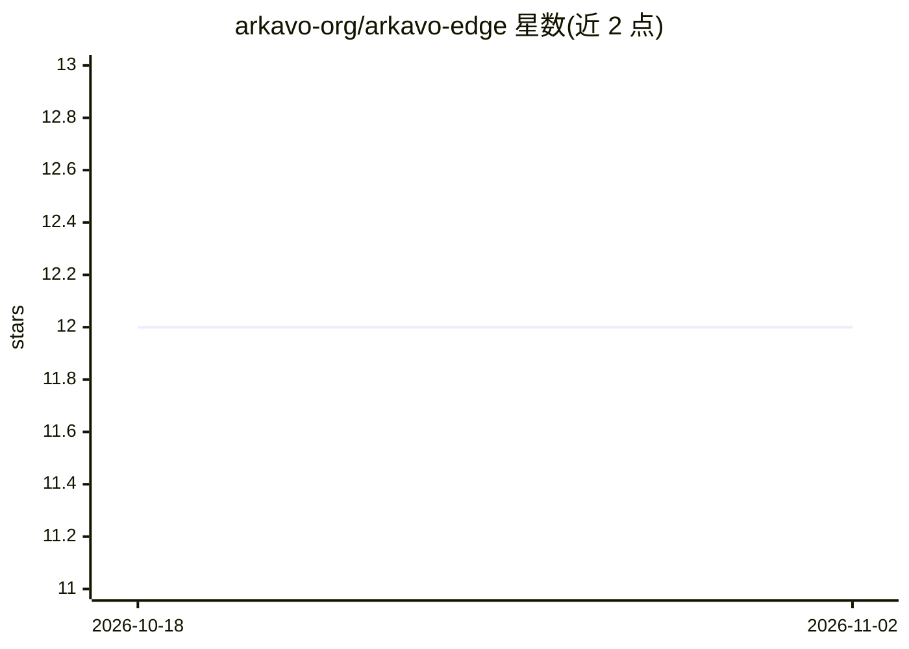

# arkavo-org/arkavo-edge

⭐ 12 · Rust · Apache-2.0 · 推送 2026-10-31 · [GitHub](https://github.com/arkavo-org/arkavo-edge) · 组织维护

**本地优先的 Rust AI agent 编排工具：启动、组网、监控 agent**

面向个人与小团队的命令行 AI agent 运行时，Rust 编写。单命令零配置启动 agent，本机与局域网内 agent 经 mDNS 自动发现并组成 mesh；首次运行按设备下载本地模型（Gemma 4 E2B 路由 + 更大推理模型）。支持多供应商路由（OpenAI/Anthropic/Gemini/Kimi/DeepSeek/本地模型），本地推理经 llama.cpp。提供 SwarmKit 声明式多 agent 套件（每角色 TDF 属性释放策略）、硬预算控制、OpenTDF 端到端加密、MCP 工具集（代码搜索、安全扫描、测试运行、浏览器自动化）。RPC 端点暂未鉴权，需在可信网络运行或绑定 127.0.0.1；Windows 构建无本地推理后端。

## 筛选速览

| 维度 | 判定 | 备注 |
|---|---|---|
| AI 角色 | `ai-ecosystem` | LLM/agent 周边工具 |
| 许可风险 | `permissive` | Apache-2.0 |
| 部署形态 | `desktop` | 安装包/桌面程序 |
| 模型依赖 | local-ok | 支持本地模型 |
| 硬件要求 | — | 无带数字的原话,不猜 |
| 安装摩擦 | `medium` | 含编译或系统依赖之一 |
| 成熟度 | — | 结构信号不足 |

## 能力要点

- mDNS 自动发现组成本地 agent mesh，零配置启动
- SwarmKit 声明式多 agent 套件，每角色独立 TDF 属性释放策略
- 多供应商路由（OpenAI/Anthropic/Gemini/Kimi/DeepSeek）+ llama.cpp 本地模型
- 内置 MCP 编码工具集：ripgrep 搜索、Semgrep/OSV/SBOM 扫描、多语言测试运行

## 适用场景

- 在本机和局域网设备上快速跑起互相协作的 AI agent
- 用声明式 kit 定义多角色 agent 流程并控制数据访问边界
- 离线用本地 Gemma/Ministral 模型做 chat 与代码任务

## 场景标签

`Agent 框架` `多智能体` · 领域:Agent 开发

## 证据(README 行号)

> L3: Instant, secure orchestration for AI agents—launch, mesh, and monitor in real time.
> L83: - **Zero config:** Just run `arkavo`. Auto-naming, auto-routing, and auto-discovery between agents on the same mach
> L89: Declarative multi-agent kits where each role declares its own TDF Attribute Release Policy. The orchestrator constr

## 星数曲线

2026-10-18 12 → 2026-11-02 12（+0）

---
*卡片 v1 · prompt 1.4 · 生成 2026-11-01 · 置信度 high · 依据 README sha `b65dda010a98` · [字段定义](../../DATASET.md)*
