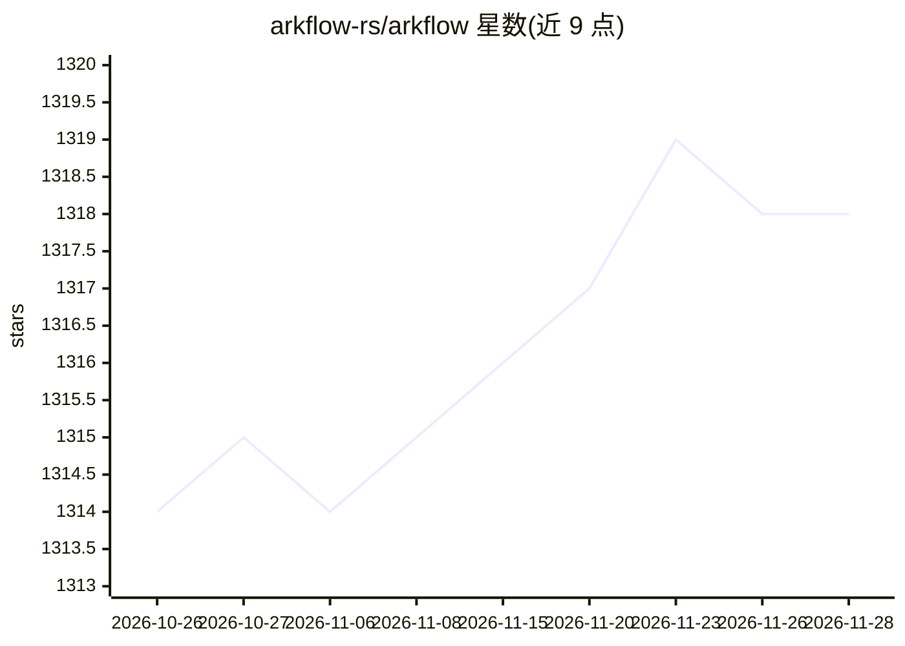

# arkflow-rs/arkflow

⭐ 1,318 · Rust · Apache-2.0 · 推送 2026-11-27 · [GitHub](https://github.com/arkflow-rs/arkflow) · [官网](https://arkflow-rs.com/) · 组织维护

**Rust 流处理引擎：在实时数据管道中接入 LLM/嵌入/向量检索**

基于 Rust 与 Tokio 异步运行时的流处理引擎，输入支持 Kafka、MQTT、HTTP、文件、SQL 数据库、NATS、Redis、Modbus 等，输出覆盖 Kafka、InfluxDB、MongoDB、Qdrant、Milvus、pgvector 等目标。处理器内置 SQL 查询、Python UDF、JSON/Protobuf 编解码、VRL，并提供 embedding、LLM（OpenAI 兼容 API）、Qdrant/Milvus/pgvector 向量检索处理器；支持会话/滚动窗口缓冲与 WAL 持久投递，另有可选 Hub 控制面与 Web 控制台。已收入 CNCF Cloud Native Landscape。

## 筛选速览

| 维度 | 判定 | 备注 |
|---|---|---|
| AI 角色 | `ai-enhanced` | 去掉 AI 部分产品仍成立 |
| 许可风险 | `permissive` | Apache-2.0 |
| 部署形态 | `self-host` | docker 或自建部署 |
| 模型依赖 | — | README 未给出锁定关系 |
| 硬件要求 | — | 无带数字的原话,不猜 |
| 安装摩擦 | `low` | 无编译、无系统依赖或容器化 |
| 成熟度 | — | 结构信号不足 |

## 能力要点

- 流处理管道中内置 LLM、embedding、向量搜索处理器（OpenAI 兼容 API）
- 输入/输出组件覆盖 Kafka、MQTT、SQL、NATS、Redis、Modbus、Qdrant、Milvus 等
- 支持 WAL 持久投递、会话/滚动窗口与 Python UDF
- 可选 Hub 控制面与 Web 控制台管理多节点

## 适用场景

- 从 Kafka/MQTT 读取流数据经 SQL 与 LLM 处理后写回目标系统
- 批量对文本列做嵌入并写入 Qdrant/Milvus/pgvector 向量库
- 通过向量检索在流中对每行数据做最近邻匹配增强
- 物联网设备经 Modbus 接入进行实时处理

## 场景标签

 · 领域:数据基础设施/流处理

## 证据(README 行号)

> L12: High performance Rust stream processing engine seamlessly integrates AI capabilities,
> L129: - **Embedding** (`embedding`): Batch-embed a text column via an OpenAI-compatible API and append vector columns
> L27: - **Multiple Data Sources**: Support for Kafka, MQTT, HTTP, files, SQL databases, and many other input/output sourc

## 星数曲线

2026-10-26 1,314 → 2026-11-28 1,318（+4）

---
*卡片 v1 · prompt 1.4 · 生成 2026-11-28 · 置信度 high · 依据 README sha `70ecfd0182a2` · [字段定义](../../DATASET.md)*
