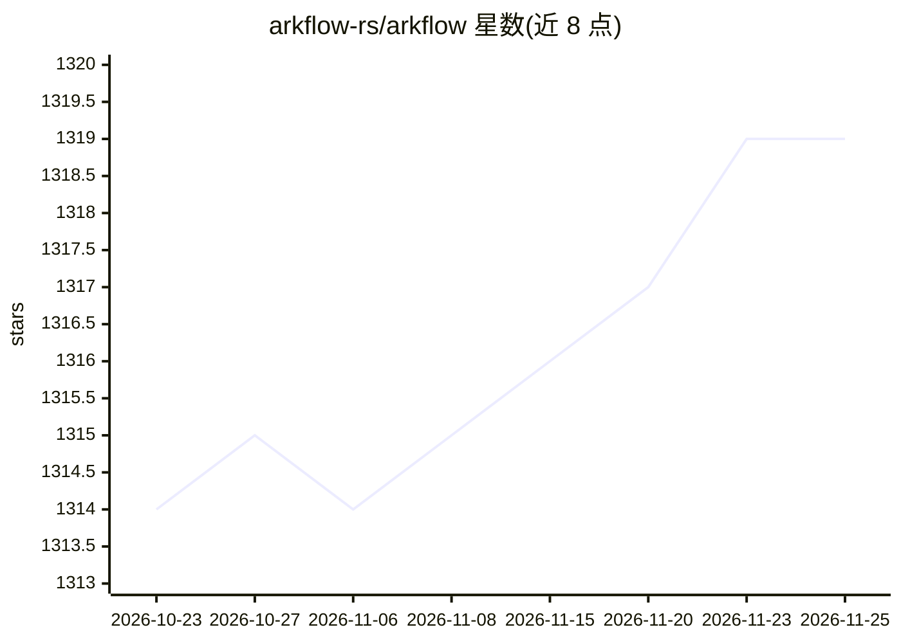

# arkflow-rs/arkflow

⭐ 1,319 · Rust · Apache-2.0 · 推送 2026-11-24 · [GitHub](https://github.com/arkflow-rs/arkflow) · [官网](https://arkflow-rs.com/) · 组织维护 · 中文 README

**面向开发者的 Rust 流处理引擎，内置 LLM/向量检索处理**

基于 Rust 与 Tokio 异步运行时的流处理引擎，支持 Kafka、MQTT、HTTP、文件、SQL、NATS 等多种输入输出源，内置 SQL 查询、Python UDF、JSON/Protobuf 编解码、VRL 等处理器。AI 侧提供 Embedding 批量嵌入、OpenAI 兼容 chat completions 调用（LLM 处理器）、Qdrant/Milvus/pgvector 向量检索等处理器，可对流数据做推理、异常检测与复杂事件处理。支持会话/滚动窗口缓冲、WAL 持久化投递，并提供可选的 Hub 控制面与 Web 控制台管理多节点。

## 筛选速览

| 维度 | 判定 | 备注 |
|---|---|---|
| AI 角色 | `ai-ecosystem` | LLM/agent 周边工具 |
| 许可风险 | `permissive` | Apache-2.0 |
| 部署形态 | `self-host` | docker 或自建部署 |
| 模型依赖 | — | README 未给出锁定关系 |
| 硬件要求 | — | 无带数字的原话,不猜 |
| 安装摩擦 | `low` | 无编译、无系统依赖或容器化 |
| 成熟度 | — | 结构信号不足 |

## 能力要点

- Embedding、LLM、Qdrant/Milvus/pgvector 向量检索等流内处理器
- Kafka/MQTT/HTTP/SQL/Redis 等十余种输入输出组件
- 内存/会话/滚动窗口缓冲与可选 WAL 持久化
- Docker 镜像发布于 GHCR，支持源码构建

## 适用场景

- 从 Kafka 读取流数据经 SQL/LLM 处理后写回 Kafka
- 对流中文本列批量生成向量并写入 Qdrant/Milvus/pgvector
- 接入 MQTT/Modbus 设备数据做实时处理与异常检测
- 按会话或滚动窗口对消息做聚合处理

## 场景标签

 · 领域:数据基础设施/流处理

## 证据(README 行号)

> L12: High performance Rust stream processing engine seamlessly integrates AI capabilities,
> L14: It not only supports multiple input/output sources and processors, but also integrates LLM, embedding, and vector-s
> L129: - **LLM** (`llm`): Send each row to an OpenAI-compatible chat completions API with bounded concurrency and append 

## 星数曲线

2026-10-23 1,314 → 2026-11-25 1,319（+5）

---
*卡片 v1 · prompt 1.4 · 生成 2026-11-23 · 置信度 high · 依据 README sha `54fec30df252` · [字段定义](../../DATASET.md)*
