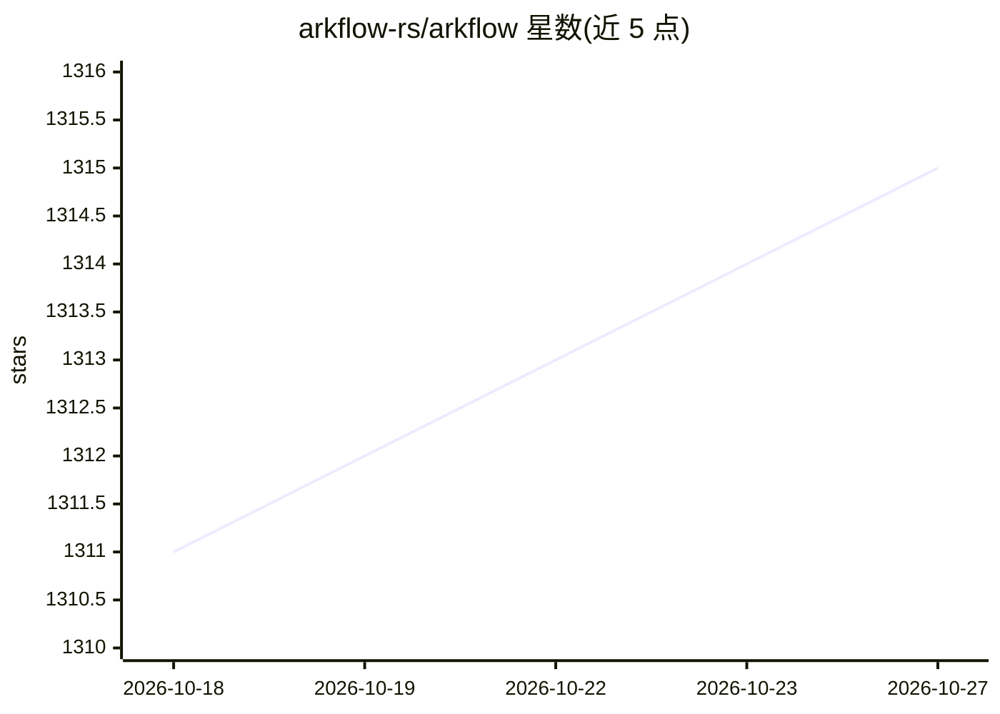

# arkflow-rs/arkflow

⭐ 1,315 · Rust · Apache-2.0 · 推送 2026-10-25 · [GitHub](https://github.com/arkflow-rs/arkflow) · [官网](https://arkflow-rs.com/) · 组织维护 · 中文 README

**Rust 流处理引擎，管道内置 LLM/嵌入/向量检索处理器**

基于 Rust 与 Tokio 的流处理引擎，通过 YAML 配置编排输入、缓冲、处理、输出四类组件：输入支持 Kafka、MQTT、NATS、SQL 数据库、Redis、Modbus 等，处理层提供 SQL、VRL、Python UDF 及 AI 类处理器（OpenAI 兼容 API 的 LLM 与嵌入、Qdrant/Milvus/pgvector 向量检索），输出覆盖 Kafka、InfluxDB、MongoDB 及向量库。默认基于 WAL 提供 at-least-once 投递。安装方式为从源码编译，产品已列入 CNCF Cloud Native Landscape。

## 筛选速览

| 维度 | 判定 | 备注 |
|---|---|---|
| AI 角色 | `ai-enhanced` | 去掉 AI 部分产品仍成立 |
| 许可风险 | `permissive` | Apache-2.0 |
| 部署形态 | `None` |  |
| 模型依赖 | — | README 未给出锁定关系 |
| 硬件要求 | — | 无带数字的原话,不猜 |
| 安装摩擦 | `low` | 无编译、无系统依赖或容器化 |
| 成熟度 | — | 结构信号不足 |

## 能力要点

- 管道处理器中提供 LLM、Embedding、Qdrant/Milvus/pgvector 向量检索组件
- 输入/输出覆盖 Kafka、MQTT、NATS、Pulsar、SQL 数据库、Redis、Modbus 等
- 内置 SQL、VRL、Python UDF、Protobuf/JSON 编解码与 Debezium CDC
- per-stream WAL 默认 at-least-once，事务 sink 可选 exactly-once

## 适用场景

- 在 Kafka 等消息流上做实时 SQL 过滤与转换
- 对流式数据逐行调用 LLM 或做向量检索并附加结果列
- 将流数据写入向量库或时序数据库构建实时管道

## 场景标签

`工作流自动化` · 领域:效率与自动化

## 证据(README 行号)

> L12: High performance Rust stream processing engine seamlessly integrates AI capabilities,
> L14: It not only supports multiple input/output sources and processors, but also enables easy loading and execution of m
> L15: enabling streaming data and inference, anomaly detection, and complex event processing.
> L112: - **LLM** (`llm`): Send each row to an OpenAI-compatible chat completions API with bounded concurrency and append 

## 星数曲线

2026-10-18 1,311 → 2026-10-27 1,315（+4）

---
*卡片 v1 · prompt 1.4 · 生成 2026-10-21 · 置信度 high · 依据 README sha `b89c64f2d7da` · [字段定义](../../DATASET.md)*
