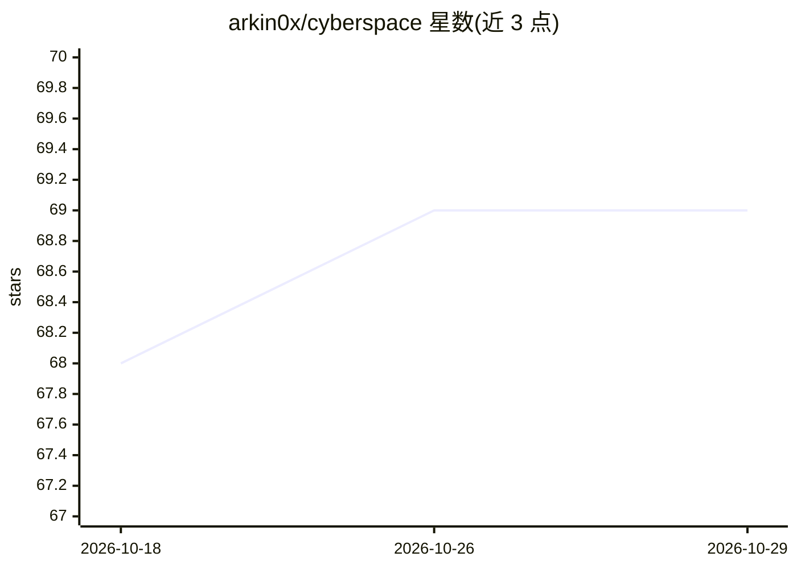

# arkin0x/cyberspace

⭐ 69 · Python · NOASSERTION · 推送 2026-10-26 · [GitHub](https://github.com/arkin0x/cyberspace) · [官网](https://onosendai.tech) · 个人维护

**给开发者的热力学空间协议：用计算工作量给数字系统施加位置性**

一个基于 Nostr 的无许可空间协议规范（当前 v2，v1 已废弃归档）：通过计算 Cantor 配对树使移动成本随距离增长，以哈希链记录可验证的移动历史，并支持基于区域的分层加密（只有完成计算工作才能解密内容）。用例包括 AI 具身化与单位置限制、无需信任的按位置数据访问、开放的 AR 覆盖层。README 亦列明不提供物理位置证明、默认隐私、女巫抵抗等限制。参考实现为独立仓库的 cyberspace-cli（Python）。

## 筛选速览

| 维度 | 判定 | 备注 |
|---|---|---|
| AI 角色 | `ai-enhanced` | 去掉 AI 部分产品仍成立 |
| 许可风险 | `none` | NOASSERTION |
| 部署形态 | `None` |  |
| 模型依赖 | — | README 未给出锁定关系 |
| 硬件要求 | — | 无带数字的原话,不猜 |
| 安装摩擦 | `low` | 无编译、无系统依赖或容器化 |
| 成熟度 | `idea` | |

## 能力要点

- 移动需计算 Cantor 配对树，成本随距离扩展
- 基于区域密钥的分层位置加密（到场才能解密）
- 构建于 Nostr（NIP-01，事件 kind 3333/33330），无需新网络设施
- 提供 AI agent 具身化指南（cyberspace-mcp 相关 docs/agents.md）

## 适用场景

- 为数字实体施加可验证的单位置约束
- 构建只有完成位置计算工作才能访问的数据
- 在物理世界上叠加无人拥有的加密 AR 层

## 场景标签

 · 领域:分布式协议/数字空间基础设施

## 证据(README 行号)

> L17: - Constrain a digital entity to one verifiable location at a time (AI embodiment, single-presence restriction)
> L82: - `docs/agents.md` is the guide for AI agents that get a body in cyberspace through cyberspace-mcp: the rules with 

## 星数曲线

2026-10-18 68 → 2026-10-29 69（+1）

---
*卡片 v1 · prompt 1.4 · 生成 2026-10-24 · 置信度 mid · 依据 README sha `f79f89210438` · [字段定义](../../DATASET.md)*
