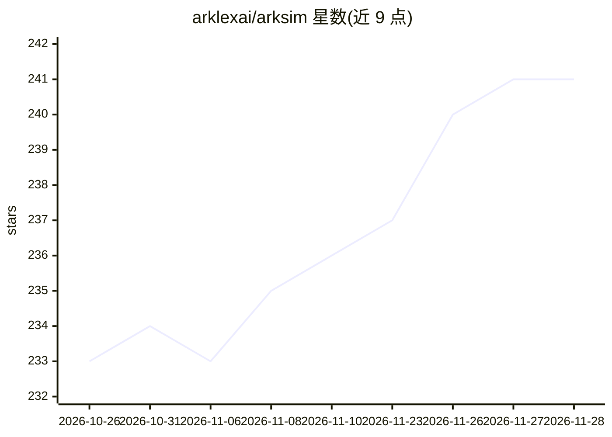

# arklexai/arksim

⭐ 241 · Python · Apache-2.0 · 推送 2026-11-13 · [GitHub](https://github.com/arklexai/arksim) · [官网](https://docs.arklex.ai) · 组织维护

**在上线前用合成用户多轮对话测试 AI agent 并生成评测报告**

ArkSim 是面向 agent 开发者的多轮对话仿真与评测工具：用户定义场景，工具生成带独立画像、目标与知识水平的 LLM 合成用户，与被测 agent 进行多轮对话，并按 helpfulness、faithfulness、goal completion 等指标逐轮评估，输出包含逐轮失败定位的交互式报告。支持通过 Python 类、Chat Completions 端点或 A2A 协议接入被测 agent，声明兼容 14+ 框架，可在 CI 中作为质量门（低于阈值时非零退出）。以 PyPI 包分发，Apache-2.0 许可，数据在本地基础设施运行。

## 筛选速览

| 维度 | 判定 | 备注 |
|---|---|---|
| AI 角色 | `ai-ecosystem` | LLM/agent 周边工具 |
| 许可风险 | `permissive` | Apache-2.0 |
| 部署形态 | `library` | 以包/库形式分发 |
| 模型依赖 | locked-api |  |
| 硬件要求 | — | 无带数字的原话,不猜 |
| 安装摩擦 | `low` | 无编译、无系统依赖或容器化 |
| 成熟度 | — | 结构信号不足 |

## 能力要点

- 生成多轮合成用户对话，逐轮评估 helpfulness/faithfulness/goal completion 等指标
- 支持 Python 类、Chat Completions 端点、A2A 协议三种 agent 接入方式
- 声明通过三种协议兼容 14+ 框架
- 内置 Claude Code 技能包与 MCP server，可在编辑器内运行仿真与调试

## 适用场景

- agent 上线前在仿真对话中发现多轮才暴露的失败
- 在 CI 中对每个 PR 运行 agent 质量门
- 浏览逐轮对话转录定位工具误调用或幻觉

## 场景标签

`模型评测` · 领域:评测与运维

## 证据(README 行号)

> L27: You define scenarios, ArkSim simulates conversations, then evaluates every turn across metrics like helpfulness, fa
> L105: - **Any agent, any framework.** Works with 14+ frameworks through Chat Completions, A2A, or direct Python import.
> L106: - **Runs in CI.** Add it as a quality gate on every PR. Exits non-zero when your agent drops below threshold.

## 星数曲线

2026-10-26 233 → 2026-11-28 241（+8）

---
*卡片 v1 · prompt 1.4 · 生成 2026-11-25 · 置信度 high · 依据 README sha `2e718494cf66` · [字段定义](../../DATASET.md)*
