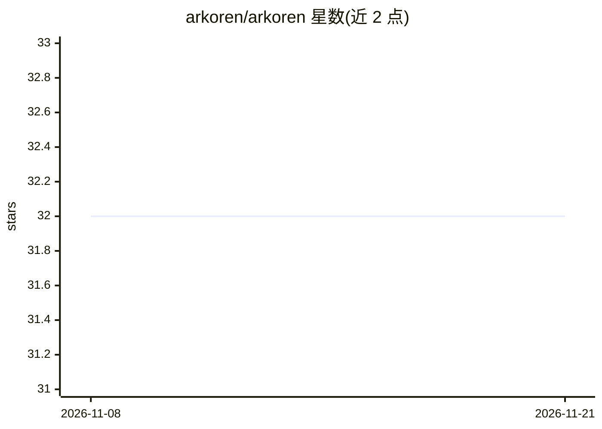

# arkoren/arkoren

⭐ 32 · Go · MIT · 推送 2026-11-19 · [GitHub](https://github.com/arkoren/arkoren) · [官网](https://arkoren.dev) · 个人维护

**给 Go 开发者的模块化后端服务工具箱（HTTP/数据/队列/可观测）**

面向 Go 开发者的模块化工具箱，围绕 net/http、context.Context、log/slog 等 stdlib 类型设计，提供缓存、数据库、存储、搜索、广播、邮件、支付、队列、工作流、加密、密钥管理、语言模型与可观测性等共享服务契约，并按需引入 Redis、PostgreSQL、NATS、Temporal、OpenAI、OpenTelemetry 等驱动。核心模块无第三方依赖，驱动为独立 Go module。另含会话、认证、CAPTCHA、Webhook、MCP 协议适配等 HTTP 能力。pre-1.0 阶段，v0 minor 版本可能破坏 API。

## 筛选速览

| 维度 | 判定 | 备注 |
|---|---|---|
| AI 角色 | `ai-ecosystem` | LLM/agent 周边工具 |
| 许可风险 | `permissive` | MIT |
| 部署形态 | `None` |  |
| 模型依赖 | — | README 未给出锁定关系 |
| 硬件要求 | — | 无带数字的原话,不猜 |
| 安装摩擦 | `low` | 无编译、无系统依赖或容器化 |
| 成熟度 | `idea` | |

## 能力要点

- 覆盖数据/应用/后台/安全/AI/运维六大类的服务契约与可插拔驱动
- stdlib-first 设计，核心模块无第三方依赖，驱动独立成 Go module
- 每个服务契约附带 conformance 测试套件
- MCP 协议适配器（基于官方 SDK）与 OpenAI/OpenAI 兼容语言模型驱动

## 适用场景

- 在现有 Go 应用中按需引入缓存、队列、邮件等单个服务
- 从各模块组合搭建 HTTP 微服务
- 本地开发用 memory/test fake 驱动，生产切换到 Redis、PostgreSQL、NATS 等后端

## 场景标签

 · 领域:后端开发/微服务基础设施

## 证据(README 行号)

> L64: |Service|Use it for|Local / test option|Driver choices|
> L93: |MCP|Typed application tools, served through the optional official-SDK protocol adapter|

## 星数曲线

2026-11-08 32 → 2026-11-21 32（+0）

---
*卡片 v1 · prompt 1.4 · 生成 2026-11-18 · 置信度 high · 依据 README sha `2c400d19a011` · [字段定义](../../DATASET.md)*
