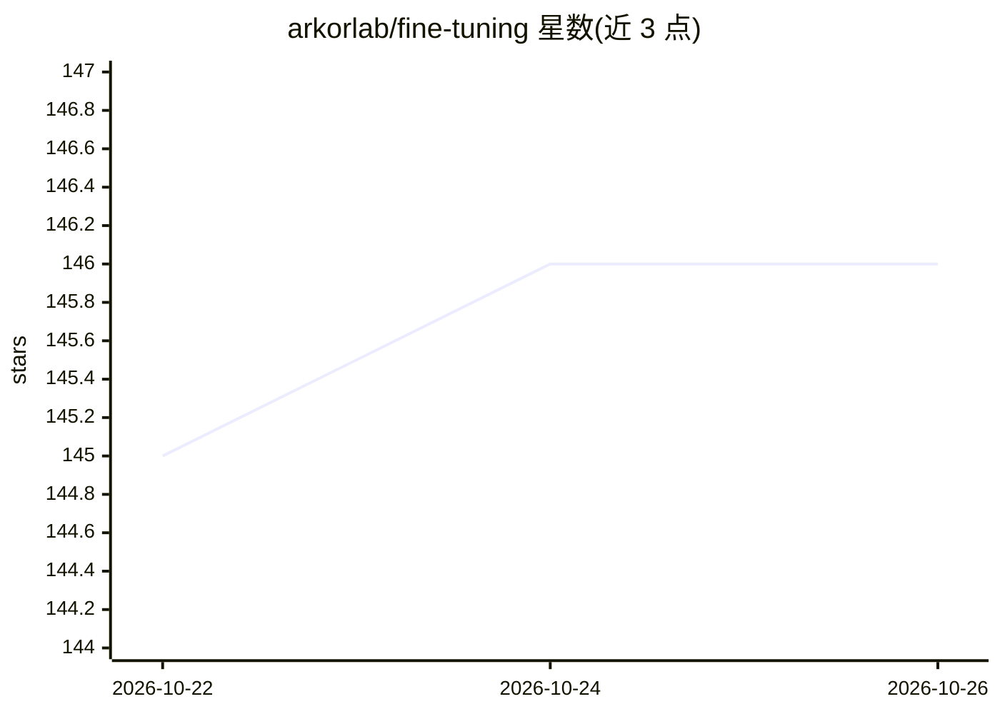

# arkorlab/fine-tuning

⭐ 146 · TypeScript · MIT · 推送 2026-10-23 · [GitHub](https://github.com/arkorlab/fine-tuning) · [官网](https://www.arkor.ai) · 组织维护 · 中文 README

**面向 TypeScript 开发者的开源 LLM 微调框架（已停止维护）**

Arkor 是一个 TypeScript 微调框架，含 SDK、CLI 与本地 Studio Web UI，通过类型安全配置（createTrainer）、生命周期回调（onStarted/onCheckpoint/onCompleted 等）与 LoRA 训练开源权重模型；提供 triage/translate/redaction 三个模板（Gemma 4 基座 + HuggingFace 公共数据集）。训练依赖已停服的 Arkor Cloud 托管 GPU 后端，官方已宣布停止维护，云相关流程不可用，源码以 MIT 许可保留供参考复用。

## 筛选速览

| 维度 | 判定 | 备注 |
|---|---|---|
| AI 角色 | `ai-ecosystem` | LLM/agent 周边工具 |
| 许可风险 | `permissive` | MIT |
| 部署形态 | `None` |  |
| 模型依赖 | — | README 未给出锁定关系 |
| 硬件要求 | — | 无带数字的原话,不猜 |
| 安装摩擦 | `low` | 无编译、无系统依赖或容器化 |
| 成熟度 | `idea` | |

## 能力要点

- TypeScript SDK + CLI + 本地 Studio（任务列表、loss 图表、Playground）
- 类型安全的 createTrainer 配置与生命周期回调
- 训练中可在 onCheckpoint 内执行 infer 测试检查点
- triage/translate/redaction 三个项目模板

## 适用场景

- 在 TypeScript 代码库中以类型安全配置编写微调训练
- 通过本地 Studio 观察训练任务与 loss 曲线
- 基于模板快速搭建分类、翻译、PII 脱敏微调项目（历史功能）

## 场景标签

`微调` · 领域:训练与推理

## 证据(README 行号)

> L5:  The TypeScript framework for fine-tuning open-weight LLMs
> L28: This repository contains the original fine-tuning framework: a TypeScript SDK, CLI, and local Studio previously off
> L64: - **Fine-tuning from a TypeScript file.** `createTrainer({ model, dataset, lora, ... })` configured LoRA training a

## 星数曲线

2026-10-22 145 → 2026-10-26 146（+1）

---
*卡片 v1 · prompt 1.4 · 生成 2026-10-22 · 置信度 high · 依据 README sha `8b607af660ae` · [字段定义](../../DATASET.md)*
