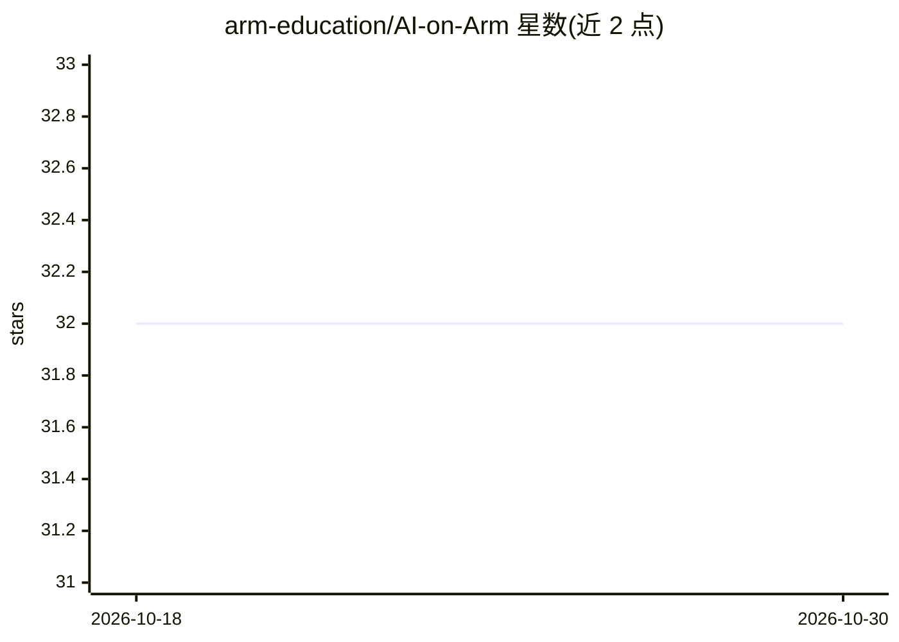

# arm-education/AI-on-Arm

⭐ 32 · Jupyter Notebook · NOASSERTION · 推送 2026-03-06 · [GitHub](https://github.com/arm-education/AI-on-Arm) · [官网](https://github.com/arm-education/AI-on-Arm/tree/main?tab=readme-ov-file#optimizing-generative-ai-on-arm-processors) · 组织维护

**Arm 处理器上生成式 AI 优化部署的实操课程**

由 Arm Education 出品的动手课程，包含三个实验与四讲讲座：在 Raspberry Pi 5 上优化移动端生成式 AI、在 AWS Graviton 云实例上部署 AI 负载、以及云与边缘推理的对比基准测试。教学覆盖 SIMD（SVE/Neon）、低比特量化、剪枝、PyTorch 与 ONNX Runtime 等软件栈。课程材料以 Jupyter Notebook 提供，通过 setup 脚本（setup_pi5.sh / setup_graviton.sh）配置环境，需登录 Hugging Face 下载大语言模型；要求具备基础机器学习知识，并自备 Raspberry Pi 5 与 Arm 云实例。

## 筛选速览

| 维度 | 判定 | 备注 |
|---|---|---|
| AI 角色 | `ai-knowledge` | 知识聚合/清单类 |
| 许可风险 | `none` | NOASSERTION |
| 部署形态 | `None` |  |
| 模型依赖 | — | README 未给出锁定关系 |
| 硬件要求 | — | 无带数字的原话,不猜 |
| 安装摩擦 | `low` | 无编译、无系统依赖或容器化 |
| 成熟度 | — | 结构信号不足 |

## 能力要点

- 三个动手实验：Raspberry Pi 5 优化、AWS Graviton 部署、云边推理对比
- 讲授 SIMD（SVE/Neon）、低比特量化、剪枝等 CPU 推理优化技术
- 覆盖 PyTorch、ONNX Runtime 与 Arm 专属优化的软件栈
- 提供 setup_pi5.sh / setup_graviton.sh 环境配置脚本

## 适用场景

- 学习在 Arm 边缘设备上高效运行生成式 AI 模型
- 在 AWS Graviton 等 Arm 云服务器上部署 AI 负载
- 对比云与边缘推理的权衡与挑战

## 场景标签

`教程课程` · 领域:学习与行业

## 证据(README 行号)

> L9: Welcome to **Optimizing Generative AI on Arm Processors**, a hands-on course designed to help you optimize generativ
> L13: This course consists of three hands-on labs and four lectures.
> L21: Inside the `slides/` folder, you will find four lectures covering the key concepts and challenges in AI inference o

## 星数曲线

2026-10-18 32 → 2026-10-30 32（+0）

---
*卡片 v1 · prompt 1.4 · 生成 2026-10-26 · 置信度 high · 依据 README sha `aaf8314d0cae` · [字段定义](../../DATASET.md)*
