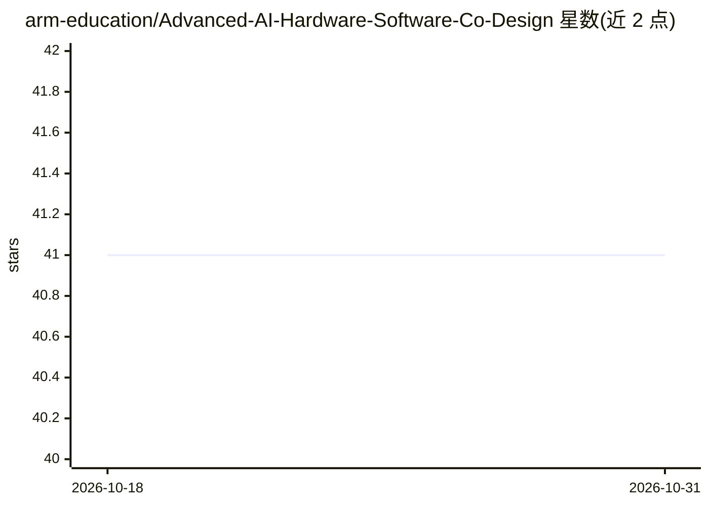

# arm-education/Advanced-AI-Hardware-Software-Co-Design

⭐ 41 · Jupyter Notebook · NOASSERTION · 推送 2025-12-08 · [GitHub](https://github.com/arm-education/Advanced-AI-Hardware-Software-Co-Design) · [官网](https://github.com/arm-education/Advanced-AI-Hardware-Software-Co-Design#advanced-quantization--a-practical-course) · 组织维护

**面向 ML 工程师的极量化与端侧 LLM 部署实训课程**

Arm 教育团队发布的实操课程（两部曲 Part 1），主题为极端模型量化、硬件感知优化与生成式 AI 模型的端侧部署。含三个 Lab：从 FP32 逐级量化到 1-bit 并实施 QAT；用自定义 QLinear 模块做逐层后训练量化与位宽搜索；用 llama.cpp 在 Android 设备上离线量化、部署与基准测试 LLaMA 类模型。面向工业界 ML 工程师与研究者，要求熟悉 transformer 架构、PyTorch 与 Python。以 Jupyter notebook 形式提供，需 GPU 加速后端训练，Android 实验需 Android Studio、NDK 与 10+ 且 ≥6GB RAM 的物理设备。

## 筛选速览

| 维度 | 判定 | 备注 |
|---|---|---|
| AI 角色 | `ai-knowledge` | 知识聚合/清单类 |
| 许可风险 | `none` | NOASSERTION |
| 部署形态 | `library` | 以包/库形式分发 |
| 模型依赖 | — | README 未给出锁定关系 |
| 硬件要求 | — | 无带数字的原话,不猜 |
| 安装摩擦 | `low` | 无编译、无系统依赖或容器化 |
| 成熟度 | — | 结构信号不足 |

## 能力要点

- Lab1：FP32→8/4/2/1-bit 渐进量化与 QAT 实现
- Lab2：nn.Linear→QLinear 逐层后训练量化与位宽配置搜索
- Lab3：llama.cpp 在 Android 设备上离线部署与基准测试 LLM
- 统一 requirements.txt + Git LFS 管理依赖与预训练模型

## 适用场景

- 学习把 LLM 压缩到超低位宽并保住精度
- 练习软硬件协同的逐层量化优化
- 在 Android 手机上离线运行和评测本地 LLM

## 场景标签

`教程课程` `模型量化` · 领域:学习与行业

## 证据(README 行号)

> L5: This course provides a hands-on introduction to *extreme model quantization*, *hardware-aware optimization*, and *on
> L23: ### Lab 1: **Extreme Quantization**

## 星数曲线

2026-10-18 41 → 2026-10-31 41（+0）

---
*卡片 v1 · prompt 1.4 · 生成 2026-10-25 · 置信度 mid · 依据 README sha `318a8f3c0bb7` · [字段定义](../../DATASET.md)*
