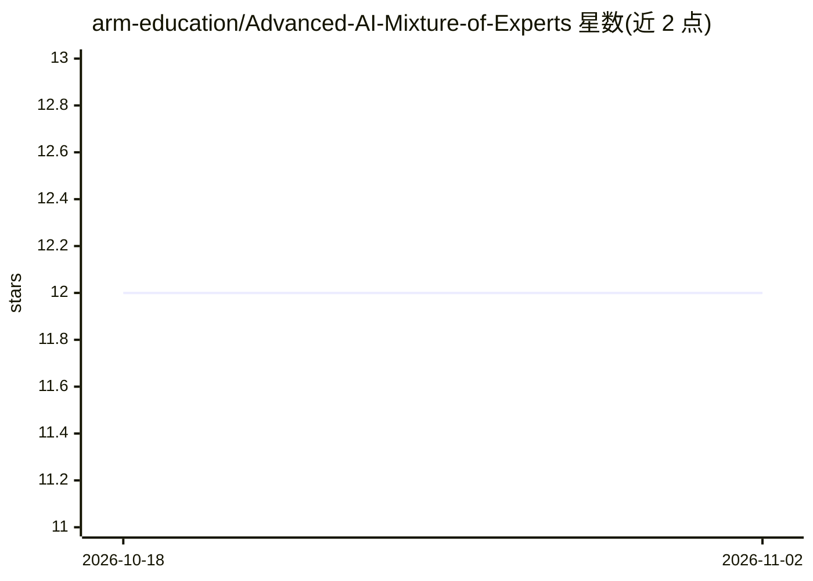

# arm-education/Advanced-AI-Mixture-of-Experts

⭐ 12 · Jupyter Notebook · NOASSERTION · 推送 2025-12-08 · [GitHub](https://github.com/arm-education/Advanced-AI-Mixture-of-Experts) · [官网](https://github.com/arm-education/Advanced-AI-Mixture-of-Experts#mixture-of-experts-a-practical-course) · 组织维护

**面向 ML 工程师的 MoE 模型实操课程（5 个递进 notebook）**

Arm Education 出品的 Mixture of Experts（MoE）动手课程，由 UT Austin 教授与 Arm 合作制作。内容分五部分：MoE 与稠密模型推理对比、构建多领域情感检测数据集、训练 transformer MoE 模型、路由与负载均衡分析、以及 EM 启发的交替优化策略（专家/门控分阶段冻结训练）。要求 Python 3.8+、PyTorch、Transformers，推荐在 Google Colab T4 GPU 环境运行，部分命令依赖 Colab 特有工具，迁移到本地需自行适配；提供各训练 epoch 的 checkpoint 下载链接。受众为工业界 ML 工程师与研究人员，需具备深度学习与 PyTorch 基础。

## 筛选速览

| 维度 | 判定 | 备注 |
|---|---|---|
| AI 角色 | `ai-knowledge` | 知识聚合/清单类 |
| 许可风险 | `none` | NOASSERTION |
| 部署形态 | `None` |  |
| 模型依赖 | — | README 未给出锁定关系 |
| 硬件要求 | — | 无带数字的原话,不猜 |
| 安装摩擦 | `low` | 无编译、无系统依赖或容器化 |
| 成熟度 | — | 结构信号不足 |

## 能力要点

- 五个递进 notebook：从 FLOP 理论分析到 MoE 训练与路由优化
- EM 启发的交替优化：E 步训练专家、M 步训练门控并加负载均衡损失
- 多领域情感数据集构建（Amazon/Yelp/IMDB）与路由分析
- 提供各 epoch 的保存 checkpoint 及加载示例

## 适用场景

- 系统学习 MoE 架构的实现与训练流程
- 在 Colab 上复现 MoE 与稠密模型的效率对比实验
- 研究专家路由与负载均衡的训练策略

## 场景标签

`教程课程` `模型训练` · 领域:学习与行业

## 证据(README 行号)

> L5: This course provides a hands-on introduction to Mixture of Experts (MoE) models through four progressive notebooks. 
> L9: This course is designed for industry ML engineers who wish to gain hands-on experience with Mixture of Experts (MoE)

## 星数曲线

2026-10-18 12 → 2026-11-02 12（+0）

---
*卡片 v1 · prompt 1.4 · 生成 2026-11-01 · 置信度 high · 依据 README sha `afe3835b7e95` · [字段定义](../../DATASET.md)*
