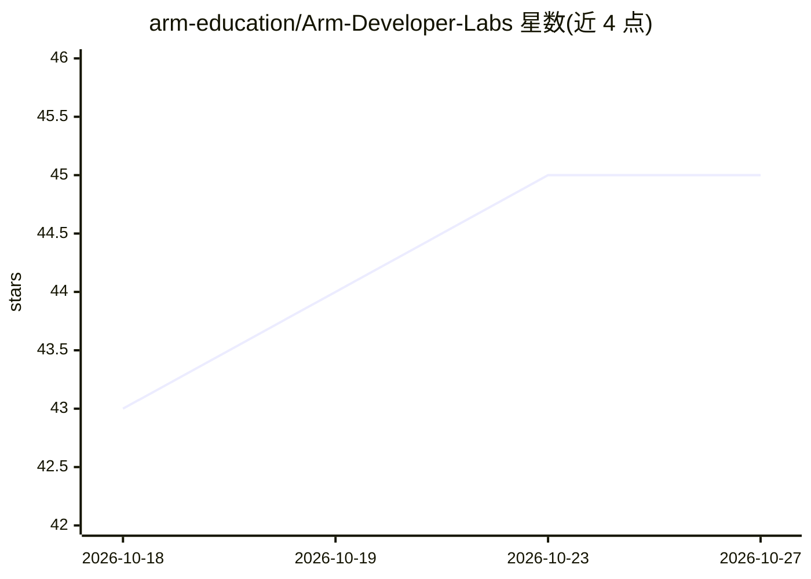

# arm-education/Arm-Developer-Labs

⭐ 45 · Python · NOASSERTION · 推送 2026-10-20 · [GitHub](https://github.com/arm-education/Arm-Developer-Labs) · [官网](https://arm-education.github.io/Arm-Developer-Labs/) · 组织维护

**Arm 官方的产业相关项目清单：面向学生与开发者**

Arm 教育团队维护的实践社区（Community of Practice），收录来自 Arm 内部团队、生态伙伴与社区成员的软硬件项目，主题涵盖 AI/ML 等领域。项目带元数据标签便于检索，可原样使用、改编或作为选题参考（学生项目、研究申请、演示原型）。提交项目需面向 Arm 平台并经在线表单审核；部分项目有 Arm Ambassadors、SoC Labs 或 Arm 工程师指导；突出贡献可获数字徽章。

## 筛选速览

| 维度 | 判定 | 备注 |
|---|---|---|
| AI 角色 | `ai-knowledge` | 知识聚合/清单类 |
| 许可风险 | `none` | NOASSERTION |
| 部署形态 | `None` |  |
| 模型依赖 | — | README 未给出锁定关系 |
| 硬件要求 | — | 无带数字的原话,不猜 |
| 安装摩擦 | `low` | 无编译、无系统依赖或容器化 |
| 成熟度 | — | 结构信号不足 |

## 能力要点

- 项目来自 Arm 内部团队、生态伙伴与社区成员
- 项目含元数据标签便于检索筛选
- 部分项目标注 Direct Arm Support 提供 Arm 工程师指导
- 突出贡献可获数字徽章用于履历

## 适用场景

- 寻找面向 Arm 平台的产业相关学生项目或研究课题
- 为研究申请或创意演示寻找项目灵感
- 提交自己的 Arm 平台项目以获得曝光与支持

## 场景标签

`精选清单` · 领域:学习与行业

## 证据(README 行号)

> L5: The state of the art of in software development is changing more rapidly than ever before. Especially in fields like
> L7: You can take a project as is, adapt it to your circumstances or simply take inspiration from it eg. for selecting st

## 星数曲线

2026-10-18 43 → 2026-10-27 45（+2）

---
*卡片 v1 · prompt 1.4 · 生成 2026-10-25 · 置信度 high · 依据 README sha `f002240f22a8` · [字段定义](../../DATASET.md)*
