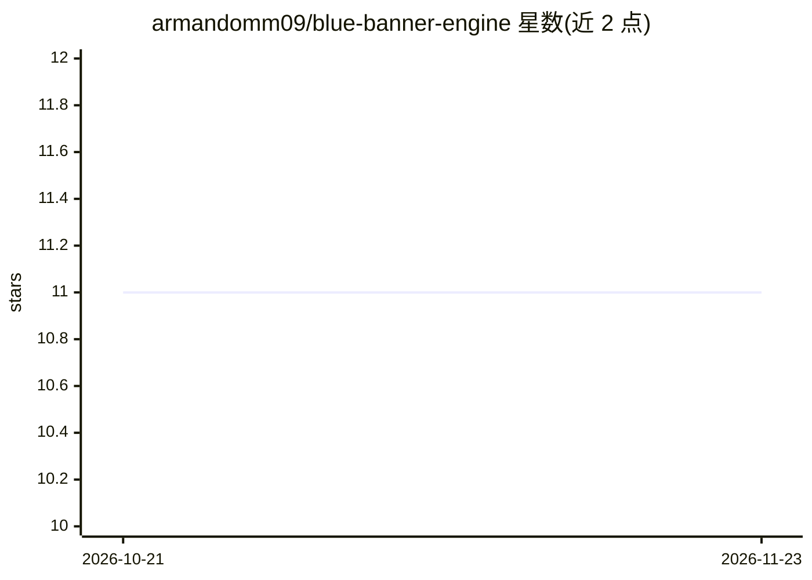

# armandomm09/blue-banner-engine

⭐ 11 · TypeScript · GPL-3.0 · 推送 2026-07-22 · [GitHub](https://github.com/armandomm09/blue-banner-engine) · [官网](https://bbe-frc.com) · 个人维护

**为 FRC 战队提供比赛预测与选队策略的 AI 侦察平台**

面向 FIRST Robotics Competition 战队的开源侦察与策略平台，包含五个模块：基于 XGBoost 预测比赛胜负与比分的 Matchpoint、用蒙特卡洛模拟生成最优选队清单的 OPL、用 SHAP 生成赛前策略简报的 Playbook、用 YOLOv8 从比赛视频生成热力图与轨迹的 Heat Seeker，以及基于 RAG 的数据问答聊天机器人 Woodie。架构为 Go API 网关 + Python ML 服务，经 gRPC 通信，多容器部署。安装运行细节指向 CONTRIBUTING.md。

## 筛选速览

| 维度 | 判定 | 备注 |
|---|---|---|
| AI 角色 | `ai-native` | 本体是模型或模型工具 |
| 许可风险 | `viral` | GPL-3.0 |
| 部署形态 | `self-host` | docker 或自建部署 |
| 模型依赖 | — | README 未给出锁定关系 |
| 硬件要求 | — | 无带数字的原话,不猜 |
| 安装摩擦 | `low` | 无编译、无系统依赖或容器化 |
| 成熟度 | — | 结构信号不足 |

## 能力要点

- XGBoost 模型预测比赛获胜联盟与最终比分
- 蒙特卡洛模拟生成联盟选队最优清单
- YOLOv8 分析比赛视频生成机器人移动热力图
- RAG 聊天机器人接入 The Blue Alliance API 查询数据

## 适用场景

- 赛前预测对阵结果并制定进攻/防守策略
- 联盟选队时评估候选队伍的协同优势
- 从比赛视频中分析队伍的场地控制与得分路径
- 通过自然语言向机器人查询 FRC 数据

## 场景标签

`聊天机器人` `RAG` `数据分析` · 领域:效率与自动化

## 证据(README 行号)

> L28: - **What:** A machine learning model that predicts match outcomes, including the winning alliance and the final sco
> L45: - **How:** It uses a YOLOv8 object detection model to identify and track robots in match footage, aggregating posit
> L54: BBE is designed with a modern, decoupled, multi-container architecture, enabling scalability and maintainability. C

## 星数曲线

2026-10-21 11 → 2026-11-23 11（+0）

---
*卡片 v1 · prompt 1.4 · 生成 2026-11-18 · 置信度 high · 依据 README sha `2879389ba04b` · [字段定义](../../DATASET.md)*
