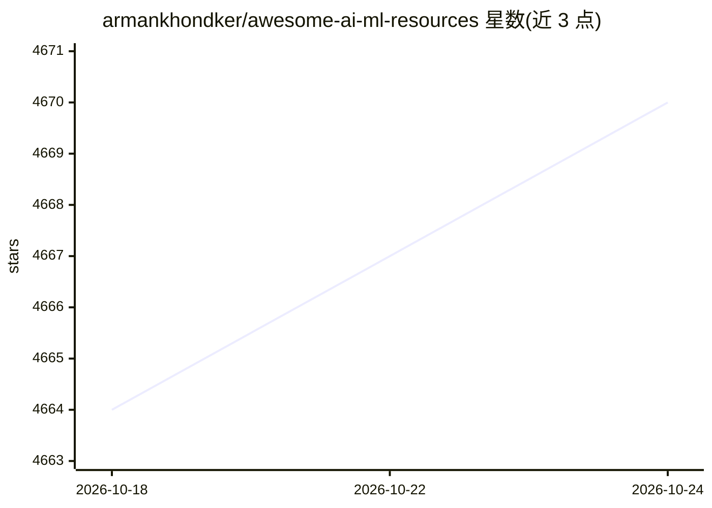

# armankhondker/awesome-ai-ml-resources

⭐ 4,671 · MIT · 推送 2026-05-09 · [GitHub](https://github.com/armankhondker/awesome-ai-ml-resources) · 个人维护

**面向初学者的 AI/ML 学习路线图与免费资源清单**

由个人维护的学习资源汇总仓库：提供 2025 年 AI/ML 学习路线图，按 8 个阶段组织（Python 与数学基础、ML 基础、实践项目、专项深化、MLOps、论文阅读、面试准备），并列出 AI/ML 关键概念、构建模块、12 种行业角色、课程、认证、书籍、工具框架、研究博客、分难度练习题、社区、YouTube 频道、 Newsletter 与必读论文等类目。内容以英文免费课程和资料为主，无代码实现。

## 筛选速览

| 维度 | 判定 | 备注 |
|---|---|---|
| AI 角色 | `ai-knowledge` | 知识聚合/清单类 |
| 许可风险 | `permissive` | MIT |
| 部署形态 | `None` |  |
| 模型依赖 | — | README 未给出锁定关系 |
| 硬件要求 | — | 无带数字的原话,不猜 |
| 安装摩擦 | `low` | 无编译、无系统依赖或容器化 |
| 成熟度 | — | 结构信号不足 |

## 能力要点

- 8 阶段学习路线图，从 Python 基础到 MLOps 与面试
- 覆盖课程、认证、书籍、研究/应用博客与必读论文等类目
- 按 Easy/Medium/Hard 分级的练习题列表
- 列出 12 种 AI/ML 相关职业角色

## 适用场景

- 作为初学者规划 AI/ML 自学路径
- 查找免费课程、书籍与研究博客等学习资料
- 准备 AI/ML 求职面试时查找参考资源

## 场景标签

`精选清单` `教程课程` · 领域:学习与行业

## 证据(README 行号)

> L1: This repository contains free resources and a roadmap to learn Machine Learning and Artificial Intelligence in 2025.
> L44: ## 🚗 AI/ML Roadmap

## 星数曲线

2026-10-18 4,664 → 2026-10-24 4,670（+6）

---
*卡片 v1 · prompt 1.4 · 生成 2026-10-20 · 置信度 high · 依据 README sha `5f64d159d411` · [字段定义](../../DATASET.md)*
