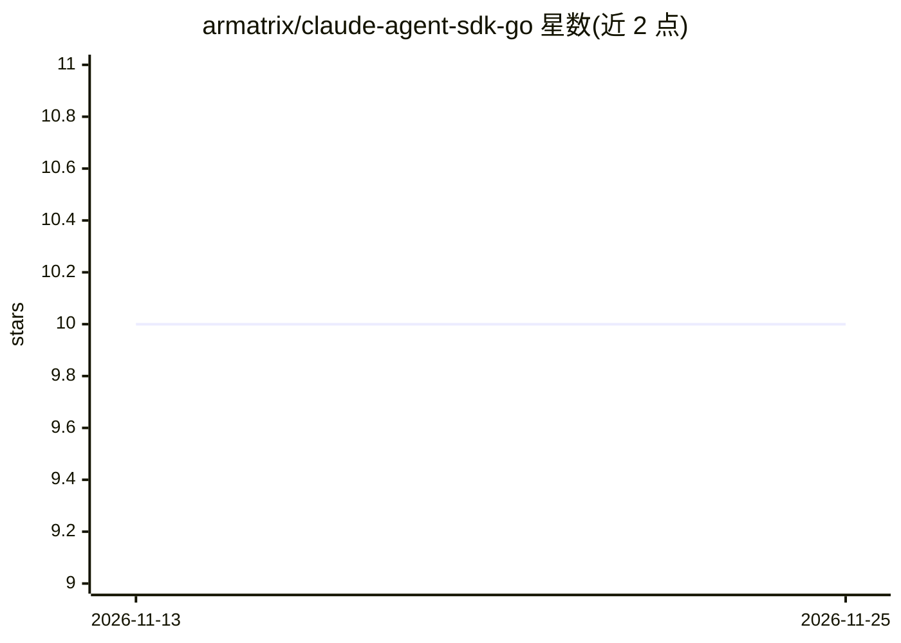

# armatrix/claude-agent-sdk-go

⭐ 10 · Go · 推送 2026-02-08 · [GitHub](https://github.com/armatrix/claude-agent-sdk-go) · [官网](https://pkg.go.dev/github.com/armatrix/claude-agent-sdk-go) · 个人维护

**Go 语言 Claude Agent SDK：单/多智能体编排**

面向 Go 开发者的 Claude Agent SDK，以纯 Go 实现构建单个 agent 或编排多智能体团队，无需子进程或 Node.js/Python 运行时。关键机制：6 种内置团队拓扑模板（Leader/Pipeline/Peer Ring/Supervisor Tree/Blackboard/MapReduce），拓扑为可组合原语；基于 goroutine 的并发；泛型 Tool 接口自动生成 JSON Schema；流式事件迭代器与上下文压缩。依赖 Go 1.23+ 与 ANTHROPIC_API_KEY；README 注明团队拓扑处于 Phase 4 开发中。

## 筛选速览

| 维度 | 判定 | 备注 |
|---|---|---|
| AI 角色 | `ai-ecosystem` | LLM/agent 周边工具 |
| 许可风险 | `permissive` | — |
| 部署形态 | `None` |  |
| 模型依赖 | locked-api |  |
| 硬件要求 | — | 无带数字的原话,不猜 |
| 安装摩擦 | `low` | 无编译、无系统依赖或容器化 |
| 成熟度 | `idea` | |

## 能力要点

- 6 种内置团队拓扑模板，可组合或自定义 Topology 接口
- 纯 Go 单二进制实现，无子进程与运行时依赖
- 泛型 Tool[T] 接口，从 struct 标签自动生成 JSON Schema
- 类型化事件流迭代器与可配置上下文压缩、预算控制

## 适用场景

- 在 Go 项目中嵌入单个 Claude agent
- 用 Pipeline/MapReduce 等拓扑编排多智能体协作
- 批量迁移、并行测试等多仓库操作场景
- 通过自定义工具扩展 agent 能力

## 场景标签

`Agent 框架` `多智能体` · 领域:Agent 开发

## 证据(README 行号)

> L3: **Pure Go Agent SDK with pluggable team topologies** — no subprocess, no runtime dependency.
> L4: Build single agents or orchestrate multi-agent teams with composable topology primitives and native goroutine concur
> L79: > **Status**: Team topologies are under active development (Phase 4). The single-agent core and built-in tools are 

## 星数曲线

2026-11-13 10 → 2026-11-25 10（+0）

---
*卡片 v1 · prompt 1.4 · 生成 2026-11-20 · 置信度 high · 依据 README sha `37e6fe3ba4a6` · [字段定义](../../DATASET.md)*
