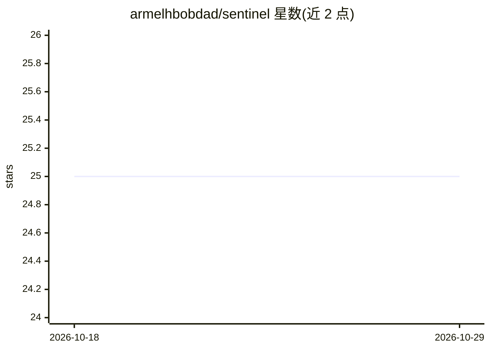

# armelhbobdad/sentinel

⭐ 25 · Python · MIT · 推送 2026-01-28 · [GitHub](https://github.com/armelhbobdad/sentinel) · 个人维护

**检测日历遗漏的能量冲突的 CLI 工具，基于知识图谱**

面向个人用户的命令行工具：用自然语言粘贴日程文本，通过 Cognee 结合 LLM 抽取实体与能量关系构建知识图谱，再用 BFS 图遍历检测多跳能量冲突（如周日晚餐影响周一演示），输出带置信度的警告与自包含 HTML 可视化报告。支持删除 AI 推断节点、确认冲突抑制警告、调节检测灵敏度。需 Python 3.11+ 与 uv，通过 git clone 源码安装，在 Debian GNU/Linux 13 上开发测试。

## 筛选速览

| 维度 | 判定 | 备注 |
|---|---|---|
| AI 角色 | `ai-native` | 本体是模型或模型工具 |
| 许可风险 | `permissive` | MIT |
| 部署形态 | `library` | 以包/库形式分发 |
| 模型依赖 | — | README 未给出锁定关系 |
| 硬件要求 | — | 无带数字的原话,不猜 |
| 安装摩擦 | `low` | 无编译、无系统依赖或容器化 |
| 成熟度 | — | 结构信号不足 |

## 能力要点

- 自然语言日程解析为知识图谱
- BFS 多跳能量冲突检测与置信度评分
- 自包含 HTML 碰撞报告与交互式 SVG 可视化
- 用户可修正 AI 推断节点并持久化修正

## 适用场景

- 粘贴日程文本，找出日历工具检不出的精力冲突
- 导出带碰撞路径高亮的 HTML 报告浏览
- 删除或确认 AI 推断的错误关系与不可避免冲突

## 场景标签

`知识图谱` · 领域:知识与检索

## 证据(README 行号)

> L17: Sentinel uses knowledge graphs to find hidden energy collisions in your schedule. Unlike traditional calendar apps 
> L31: - **Schedule Ingestion**: Parse natural language schedule descriptions into a knowledge graph
> L358: |Cognee|Knowledge graph + LLM entity extraction|

## 星数曲线

2026-10-18 25 → 2026-10-29 25（+0）

---
*卡片 v1 · prompt 1.4 · 生成 2026-10-27 · 置信度 mid · 依据 README sha `4de46c9a6faa` · [字段定义](../../DATASET.md)*
