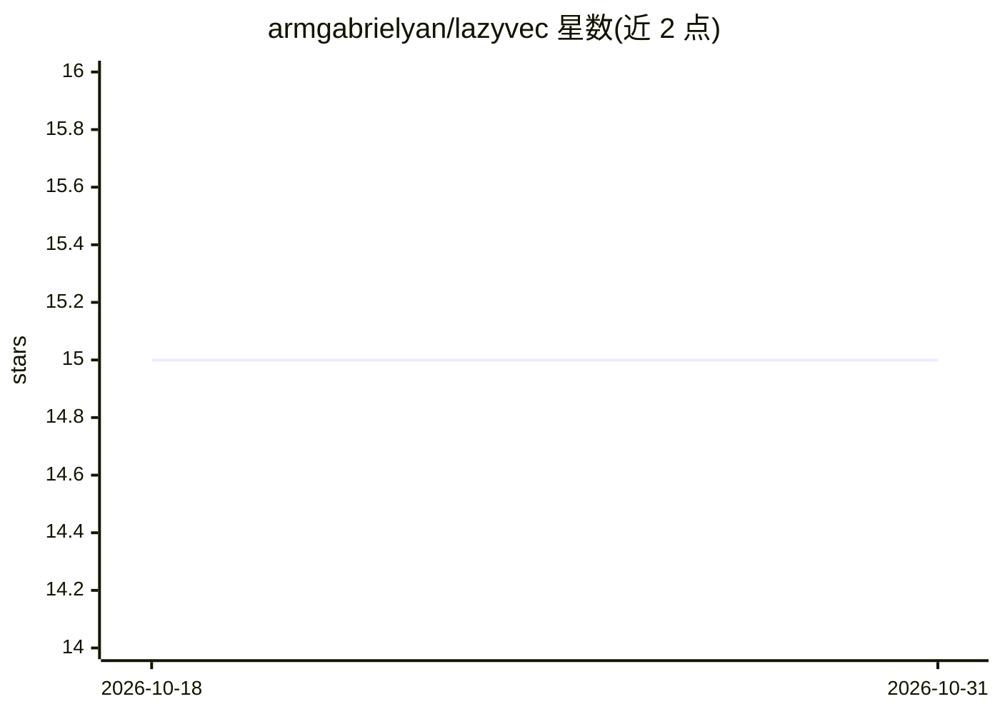

# armgabrielyan/lazyvec

⭐ 15 · TypeScript · MIT · 推送 2026-04-19 · [GitHub](https://github.com/armgabrielyan/lazyvec) · 个人维护

**浏览与检查向量数据库的终端 UI 客户端**

终端界面（TUI）工具，通过统一适配层连接 Qdrant（本地/Cloud）、Pinecone（Serverless）与 Chroma（本地/Cloud）三种向量数据库：提供连接管理（增删改、可达性检测、TOML 配置与 ${VAR} 环境变量引用）、集合与记录分页浏览、元数据过滤（各 provider 支持程度不同）、向量相似检索、记录删除（带确认与可视范围选择）、集合统计（HNSW/SPANN、分片等）与 Vim 风格复制。面向使用向量数据库的开发者；安装方式覆盖脚本安装、npm、GitHub Releases 二进制与 Bun 源码构建，Intel Mac 不提供预编译二进制。

## 筛选速览

| 维度 | 判定 | 备注 |
|---|---|---|
| AI 角色 | `ai-ecosystem` | LLM/agent 周边工具 |
| 许可风险 | `permissive` | MIT |
| 部署形态 | `desktop` | 安装包/桌面程序 |
| 模型依赖 | — | README 未给出锁定关系 |
| 硬件要求 | — | 无带数字的原话,不猜 |
| 安装摩擦 | `low` | 无编译、无系统依赖或容器化 |
| 成熟度 | — | 结构信号不足 |

## 能力要点

- 统一适配层支持 Qdrant / Pinecone / Chroma 三类 provider 的本地与云端连接
- key:value 等过滤语法与 AND 组合，按 provider 差异化支持（Pinecone 字段过滤尚未接入）
- 向量相似检索与记录删除（确认对话框、可视范围批量删除）
- Vim 风格 y{i,m,v} 复制 ID/元数据/向量，动态推断记录表列

## 适用场景

- 在终端里快速浏览和检查 Qdrant/Pinecone/Chroma 中的集合与记录
- 对某条记录做向量相似检索并查看得分
- 通过配置文件管理多个向量数据库连接并检测可达性

## 场景标签

 · 领域:开发者工具/向量数据库

## 证据(README 行号)

> L8: **A terminal UI for browsing vector databases.**
> L21: - 🔌 **Multi-provider** — Qdrant (local + Cloud), Pinecone (serverless), and Chroma (local + Cloud) behind a common 

## 星数曲线

2026-10-18 15 → 2026-10-31 15（+0）

---
*卡片 v1 · prompt 1.4 · 生成 2026-10-30 · 置信度 high · 依据 README sha `a663abce9efe` · [字段定义](../../DATASET.md)*
