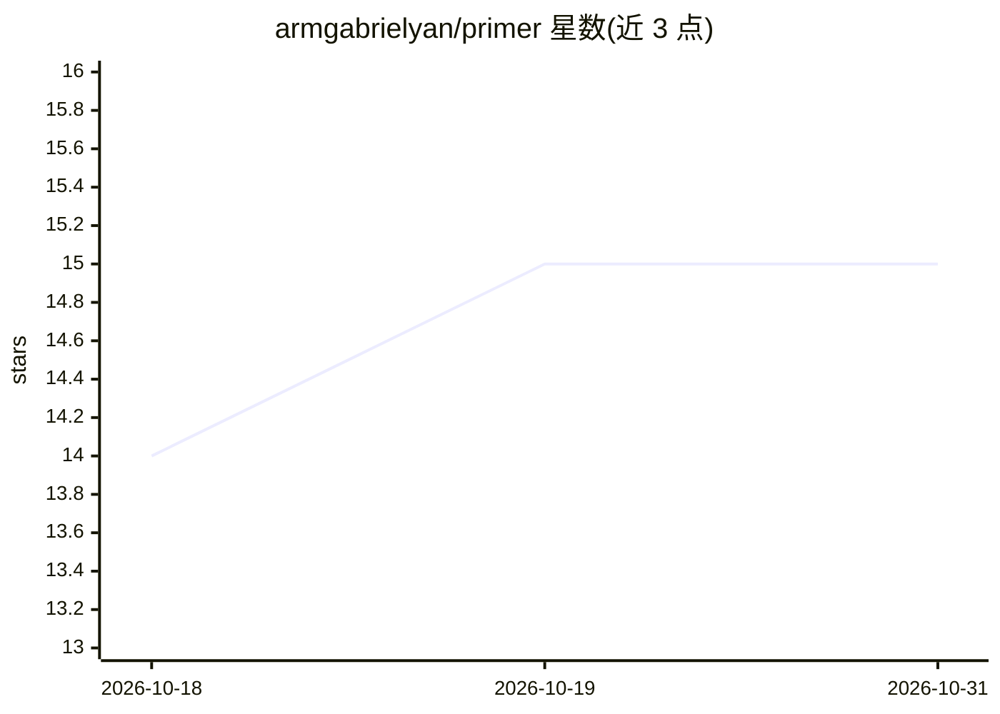

# armgabrielyan/primer

⭐ 15 · Rust · MIT · 推送 2026-03-29 · [GitHub](https://github.com/armgabrielyan/primer) · 个人维护

**给学习者的 AI 编程代理引导式构建工作流 CLI：按里程碑构建真实软件**

Rust 编写的 primer CLI 面向用 AI 编程代理（Claude Code、Codex、OpenCode、Gemini CLI、Cursor）构建软件的学习者与构建者：从配方初始化独立工作区并生成各工具专属指令文件，代理仅实现当前里程碑范围，primer-verify 校验通过后才能解锁下一步，支持 learner/builder 两种交互轨道。当前含 cli-tool、interpreter-mini、operating-system 三个配方，其中 operating-system 被标注为进阶项目。提供 curl 脚本、Homebrew、npm、Cargo、预编译二进制与源码编译多种安装方式。

## 筛选速览

| 维度 | 判定 | 备注 |
|---|---|---|
| AI 角色 | `ai-ecosystem` | LLM/agent 周边工具 |
| 许可风险 | `permissive` | MIT |
| 部署形态 | `desktop` | 安装包/桌面程序 |
| 模型依赖 | — | README 未给出锁定关系 |
| 硬件要求 | — | 无带数字的原话,不猜 |
| 安装摩擦 | `medium` | 含编译或系统依赖之一 |
| 成熟度 | `idea` | |

## 能力要点

- 为 5 种 AI 编程代理生成原生工作区适配文件
- 里程碑契约 + 验证通过才解锁下一步的工作流
- learner/builder 两种交互轨道可随时切换
- 跨 Linux/macOS/Windows 的预编译二进制与多种包管理器安装

## 适用场景

- 跟着引导式里程碑逐步构建 CLI、解释器或操作系统等真实项目
- 限制 AI 代理只做当前步骤，避免一次性交给代理模糊的大任务
- 教师或配方作者制作可复用的里程碑式学习路径

## 场景标签

`编码 Agent` · 领域:编码与开发

## 证据(README 行号)

> L5: The main work happens inside your AI coding agent. The `primer` CLI sets up the workspace, verifies prerequisites, a
> L102: 1. The setup layer: the `primer` CLI creates the workspace, checks your environment, and manages workflow state.
> L103: 2. The working layer: your AI coding agent uses the generated Primer actions inside that workspace while you build

## 星数曲线

2026-10-18 14 → 2026-10-31 15（+1）

---
*卡片 v1 · prompt 1.4 · 生成 2026-10-30 · 置信度 high · 依据 README sha `51c0a40662f7` · [字段定义](../../DATASET.md)*
