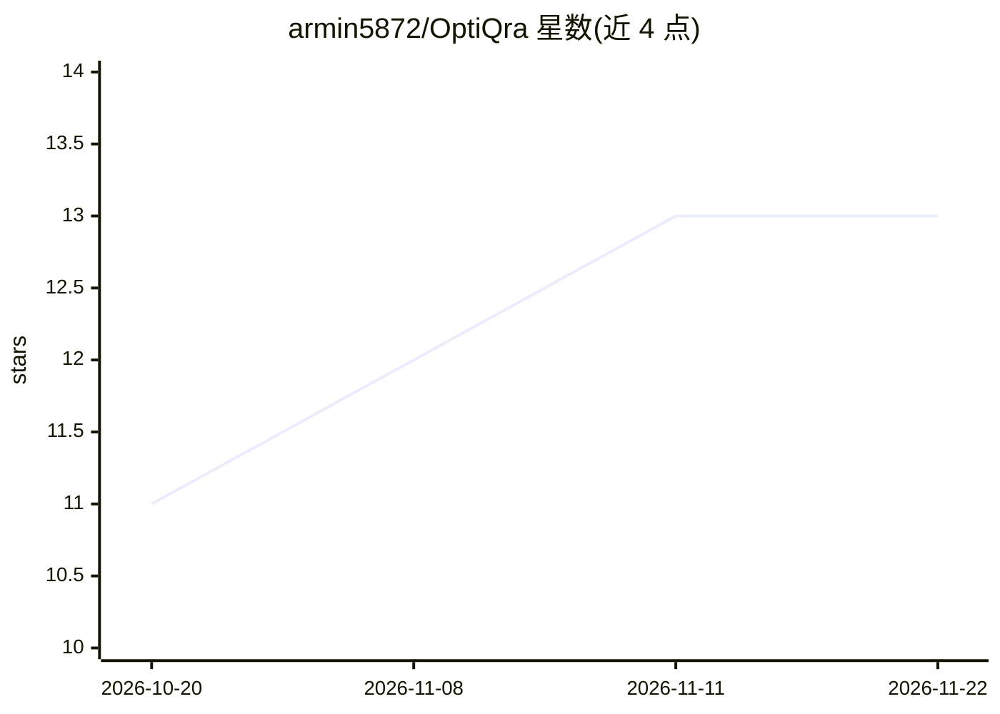

# armin5872/OptiQra

⭐ 13 · TypeScript · MIT · 推送 2026-11-16 · [GitHub](https://github.com/armin5872/OptiQra) · [官网](https://optiqra.vercel.app) · 个人维护

**面向站长的网站审计与修复工具：SEO/AEO/GEO/性能可访问性检查并自动修复**

OptiQra 通过爬取网站或上传项目压缩包，按 180+ 条规则检查 SEO、AEO、GEO、性能、可访问性、安全头与技术质量问题，并支持三个修复层级：无需 AI 的确定性自动修复、调用用户自选 AI 提供商生成内容级修复、整文件级 Full AI Fix（默认关闭）。修复经结构不变性校验，可生成高亮标注的问题克隆页，支持 2D/3D/星系式爬取可视化、PDF/DOCX/JSON 等 8 种报告导出与定时扫描。提供 Web 版、VS Code 扩展与 Tauri 2 桌面版（支持系统托盘后台扫描与自动更新）。

## 筛选速览

| 维度 | 判定 | 备注 |
|---|---|---|
| AI 角色 | `ai-enhanced` | 去掉 AI 部分产品仍成立 |
| 许可风险 | `permissive` | MIT |
| 部署形态 | `self-host` | docker 或自建部署 |
| 模型依赖 | — | README 未给出锁定关系 |
| 硬件要求 | — | 无带数字的原话,不猜 |
| 安装摩擦 | `low` | 无编译、无系统依赖或容器化 |
| 成熟度 | — | 结构信号不足 |

## 能力要点

- 180+ 条分析规则覆盖 SEO/AEO/GEO/性能/可访问性/安全
- 确定性修复无需 AI，AI 修复由用户自备 API key 直连提供商
- 支持 HTML/JSX/Vue/Nuxt/Angular/Svelte/Astro 项目审计与框架感知修复
- Tauri 2 桌面版支持系统托盘后台定时扫描与原生通知

## 适用场景

- 上线前对网站做技术与内容层面的 SEO/可访问性检查
- 检查站点对 GPTBot/ClaudeBot 等 AI 爬虫的可访问性与 llms.txt 配置
- 上传项目 zip 对代码库做离线审计并应用修复
- 定时重扫站点并对比新旧问题与分数变化

## 场景标签

 · 领域:开发者工具/网站优化

## 证据(README 行号)

> L5: **An open-source AI website optimizer that actually fixes what it finds.**
> L215: These fixes are reproducible and don't require an AI provider.
> L219: For issues that require actual writing or contextual reasoning, OptiQra can use your chosen AI provider to generat

## 星数曲线

2026-10-20 11 → 2026-11-22 13（+2）

---
*卡片 v1 · prompt 1.4 · 生成 2026-11-18 · 置信度 high · 依据 README sha `3065f7e81d1a` · [字段定义](../../DATASET.md)*
