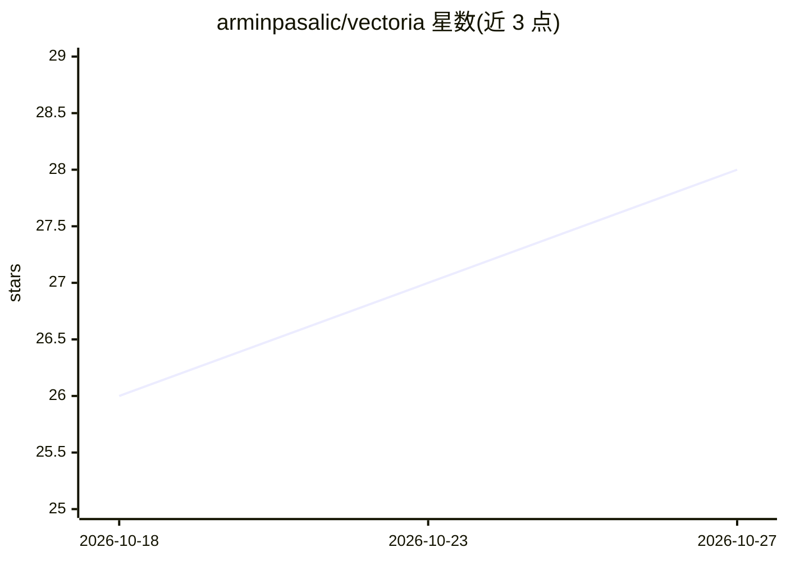

# arminpasalic/vectoria

⭐ 28 · JavaScript · MIT · 推送 2026-10-24 · [GitHub](https://github.com/arminpasalic/vectoria) · [官网](https://vectoria.app) · 个人维护

**浏览器内本地文本探索、聚类与 RAG 问答工具**

在浏览器中运行的私有文档分析应用：加载 CSV/Excel/JSON/TXT 后完成嵌入、UMAP 降维与 HDBSCAN 聚类，生成交互式 2D 语义地图；提供向量+BM25 混合搜索与 RAG 问答（本地 WebLLM 模型或经 MCP 连接的 AI 客户端两种生成模式），回答附可溯源引文。处理默认全程本地，可选重排序器与 HyDE、七种分块策略，数据经 IndexedDB 持久化。要求 Chrome/Edge 120+ 且支持 WebGPU，较大本地 LLM 需数 GB 存储。

## 筛选速览

| 维度 | 判定 | 备注 |
|---|---|---|
| AI 角色 | `ai-native` | 本体是模型或模型工具 |
| 许可风险 | `permissive` | MIT |
| 部署形态 | `library` | 以包/库形式分发 |
| 模型依赖 | — | README 未给出锁定关系 |
| 硬件要求 | — | 无带数字的原话,不猜 |
| 安装摩擦 | `low` | 无编译、无系统依赖或容器化 |
| 成熟度 | — | 结构信号不足 |

## 能力要点

- UMAP+HDBSCAN 生成交互式 2D 语义聚类地图
- RAG 问答支持本地浏览器 LLM 或 MCP 连接的 AI 客户端两种模式
- 向量+BM25 混合搜索，可选多语言交叉编码器重排序
- Chonkie 七种分块策略（含代码/语义/表格感知）

## 适用场景

- 不上传云端地对个人笔记与文档做语义搜索与问答
- 研究语料的定性探索与聚类可视化
- 企业内部文档的隐私优先语义检索

## 场景标签

`RAG` `语义搜索` `文档问答` · 领域:知识与检索

## 证据(README 行号)

> L26: - **RAG (Retrieval-Augmented Generation)** for intelligent Q&A
> L45: - **Browser-based LLM** - Multiple models (Gemma 2, Llama 3.2, Qwen 3, etc.) for RAG via WebGPU
> L152: |`llm-rag.js`|RAG Q&A|WebLLM (multi-model)|

## 星数曲线

2026-10-18 26 → 2026-10-27 28（+2）

---
*卡片 v1 · prompt 1.4 · 生成 2026-10-26 · 置信度 mid · 依据 README sha `1fc446b2111d` · [字段定义](../../DATASET.md)*
