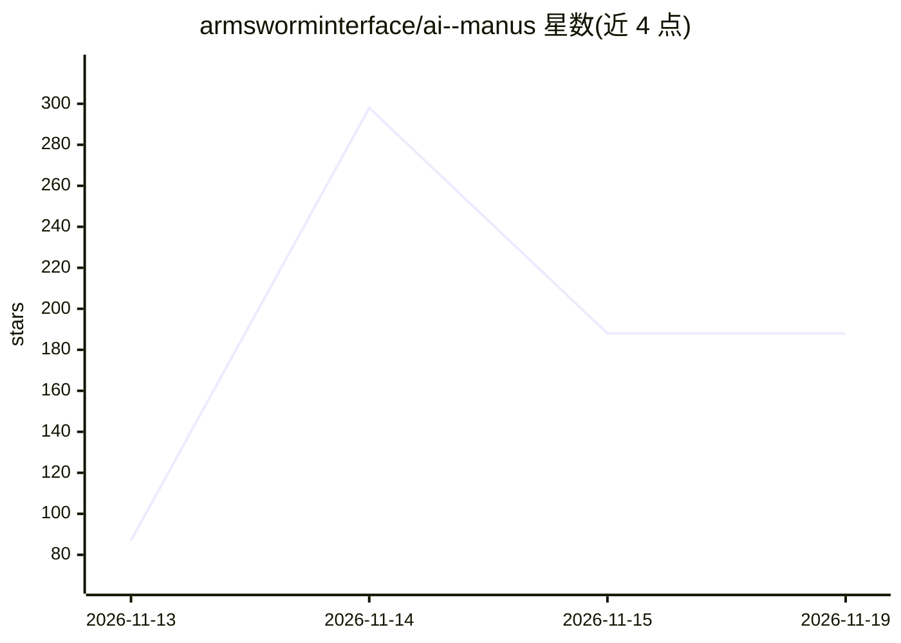

# armsworminterface/ai--manus

⭐ 188 · Apache-2.0 · 推送 2026-11-15 · [GitHub](https://github.com/armsworminterface/ai--manus) · 个人维护

**面向个人用户的自主 AI Agent：代跑代码、控制浏览器完成任务**

README 描述的通用型自主 AI Agent 系统，声称在沙箱环境中运行工具：自主编写并执行脚本、控制浏览器（导航网页、填写表单、抓取信息），并以个人助理形式在后台执行多步骤任务。目标用户为学生、远程工作者及处理小型项目的个人，定位为家庭/学习/轻量办公场景而非企业平台。README 以功能宣传为主，未给出架构、模型接入方式、代码仓库内容或安装命令，仅列出硬件兼容性表格（最低 4GB 内存、双核 CPU）。README 中反复出现 'PROMO2026' 与 'Download Manus' 等下载引导内容。

## 筛选速览

| 维度 | 判定 | 备注 |
|---|---|---|
| AI 角色 | `ai-native` | 本体是模型或模型工具 |
| 许可风险 | `permissive` | Apache-2.0 |
| 部署形态 | `None` |  |
| 模型依赖 | — | README 未给出锁定关系 |
| 硬件要求 | — | 无带数字的原话,不猜 |
| 安装摩擦 | `low` | 无编译、无系统依赖或容器化 |
| 成熟度 | — | 结构信号不足 |

## 能力要点

- 自主编写并执行代码完成任务的 Agent 能力（README 声称）
- 浏览器控制：导航网页、填表单、采集信息
- 代码与浏览器操作在同一流程内衔接的多步骤任务执行
- 声明支持在沙箱环境中运行各类工具与操作（仓库描述）

## 适用场景

- 让 Agent 代为执行网页查资料、填表单等重复性操作
- 整理研究笔记、跑小脚本等学习辅助任务
- 日常多任务委派，减少手动切换工具

## 场景标签

`AI 助手` `编码 Agent` `浏览器自动化` · 领域:效率与自动化

## 证据(README 行号)

> L10: - **Autonomous Code Execution:** Manus AI agent runs code on its own to complete tasks, so you can focus on decisio
> L18: Manus is an autonomous AI agent designed to run code and control a browser on your behalf. Instead of acting like a

## 星数曲线

2026-11-13 87 → 2026-11-19 188（+101）

---
*卡片 v1 · prompt 1.4 · 生成 2026-11-17 · 置信度 mid · 依据 README sha `0f78ee3a5dd2` · [字段定义](../../DATASET.md)*
