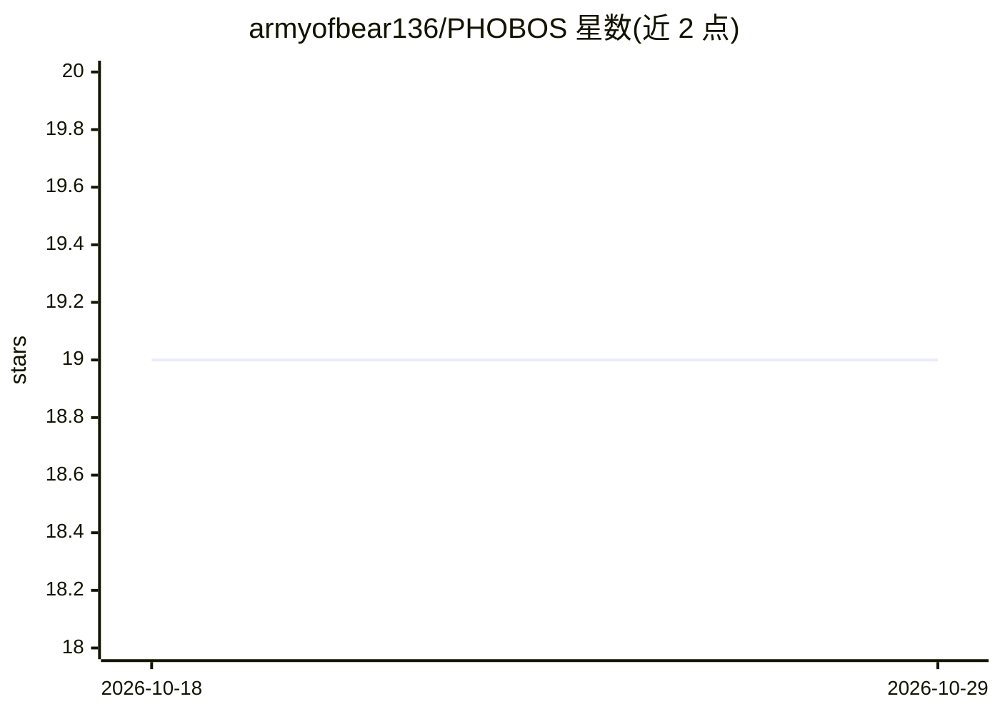

# armyofbear136/PHOBOS

⭐ 19 · TypeScript · NOASSERTION · 推送 2026-06-11 · [GitHub](https://github.com/armyofbear136/PHOBOS) · [官网](https://www.autarch.net) · 个人维护

**本地优先的自托管创意 AI 平台：LLM/图像/音频/任务编排一体**

由 Autarch Industries 维护、个人在 55 天内构建的 local-first AI 平台：Fastify 后端编译为 Node.js 单一可执行文件，通过 localhost 服务 React 前端。内含三个 AI persona（任务协调 SAYON、执行引擎 SEREN、语义记忆 SYBIL/nomic-embed），以子进程方式管理 llama-server 与 sd-cli，自动检测 NVIDIA/AMD/Intel/Apple Metal/CPU 硬件并分配 GPU。功能覆盖 LLM 推理、FLUX/SDXL 等图像与视频生成、Camoufox 浏览器、浏览器 DAW、DuckDB 语义检索、cron 任务调度与安全扫描，全部本地运行。作者同时将其定位为'供人参考自建的工作示例'而非成品。

## 筛选速览

| 维度 | 判定 | 备注 |
|---|---|---|
| AI 角色 | `ai-native` | 本体是模型或模型工具 |
| 许可风险 | `none` | NOASSERTION |
| 部署形态 | `desktop` | 安装包/桌面程序 |
| 模型依赖 | local-ok | 支持本地模型 |
| 硬件要求 | `cpu-ok` | |
| 安装摩擦 | `medium` | 含编译或系统依赖之一 |
| 成熟度 | `idea` | |

## 能力要点

- 三个 AI persona 分工：协调、执行、语义记忆（RAG/档案检索）
- 以子进程管理 llama-server 与 sd-cli，自动检测多种 GPU 路径
- 多模态套件：图像/视频生成、浏览器 DAW（VST3）、2D 游戏引擎、IPTV、安全扫描
- 事件驱动 cron 调度器（conversation/background 双模式）

## 适用场景

- 在自有硬件上运行不联网、不出本机的多模态 AI 工作站
- 通过本地 LLM 编排完成多步骤任务与内容生成
- 对本地文档做语义归档与检索

## 场景标签

`图像生成` `视频生成` `语义搜索` `多模态` · 领域:内容生成

## 证据(README 行号)

> L5: PHOBOS is a local-first AI platform that runs entirely on your hardware. It hosts its own LLM inference, image gener
> L11: PHOBOS is not a wrapper around a cloud API. It is an operating system for AI work — a Fastify backend (compiled to 
> L21: - **SAYON** — Task coordinator and agent. Plans multi-step work, calls tools, drives the loop.

## 星数曲线

2026-10-18 19 → 2026-10-29 19（+0）

---
*卡片 v1 · prompt 1.4 · 生成 2026-10-28 · 置信度 high · 依据 README sha `a6631c016d2b` · [字段定义](../../DATASET.md)*
