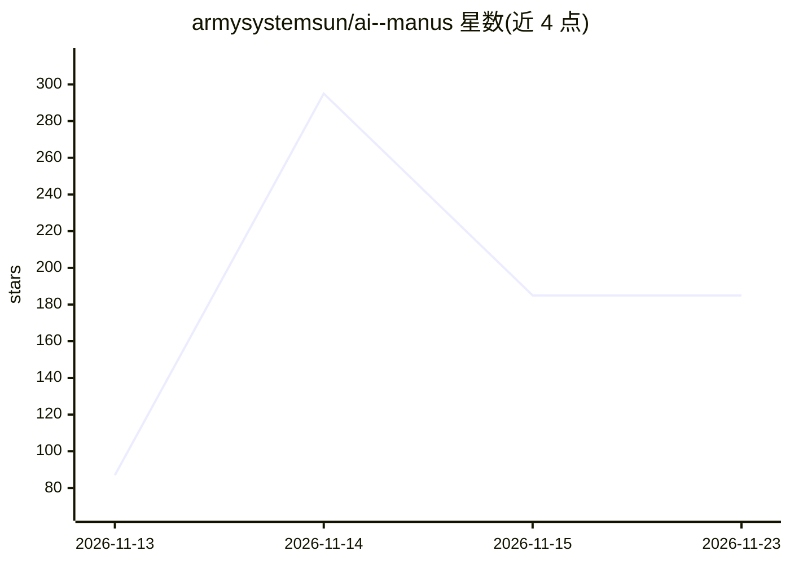

# armysystemsun/ai--manus

⭐ 185 · Apache-2.0 · 推送 2026-11-15 · [GitHub](https://github.com/armysystemsun/ai--manus) · 个人维护

**面向个人用户的自主 AI Agent：代跑代码并控制浏览器**

README 以产品介绍形式描述 Manus：一个自主 AI 代理，代表用户编写并执行脚本、打开网页、与页面元素交互、执行多步任务，定位为家庭、学习与轻量办公场景的后台个人助手，需最小监督。文内列出 CPU/内存/存储等兼容性表，并给出'准备-配置-测试-调优-应用-维护'六步上手流程，但未提供任何安装命令、代码链接或技术实现细节，也无可验证的模型接入说明，内容以功能宣传与搜索关键词列表为主。

## 筛选速览

| 维度 | 判定 | 备注 |
|---|---|---|
| AI 角色 | `ai-native` | 本体是模型或模型工具 |
| 许可风险 | `permissive` | Apache-2.0 |
| 部署形态 | `None` |  |
| 模型依赖 | — | README 未给出锁定关系 |
| 硬件要求 | — | 无带数字的原话,不猜 |
| 安装摩擦 | `low` | 无编译、无系统依赖或容器化 |
| 成熟度 | — | 结构信号不足 |

## 能力要点

- 自主执行代码：由代理自行编写并运行脚本完成任务
- 浏览器控制：导航网站、填写表单、采集信息
- 代码与浏览器操作在同一任务流中衔接
- 声明兼容性表：双核 CPU / 4GB RAM 起步，推荐 8GB 以上

## 适用场景

- 让学生整理研究笔记、跑快速计算
- 让代理代为检查网页更新、填写重复表单
- 小型项目中把重复性代码与浏览器操作交给代理处理

## 场景标签

`AI 助手` `浏览器自动化` `编码 Agent` · 领域:效率与自动化

## 证据(README 行号)

> L10: - **Autonomous Code Execution:** Manus AI agent runs code on its own to complete tasks, so you can focus on decisio
> L18: Manus is an autonomous AI agent designed to run code and control a browser on your behalf. Instead of acting like a

## 星数曲线

2026-11-13 87 → 2026-11-23 185（+98）

---
*卡片 v1 · prompt 1.4 · 生成 2026-11-17 · 置信度 low · 依据 README sha `0f78ee3a5dd2` · [字段定义](../../DATASET.md)*
