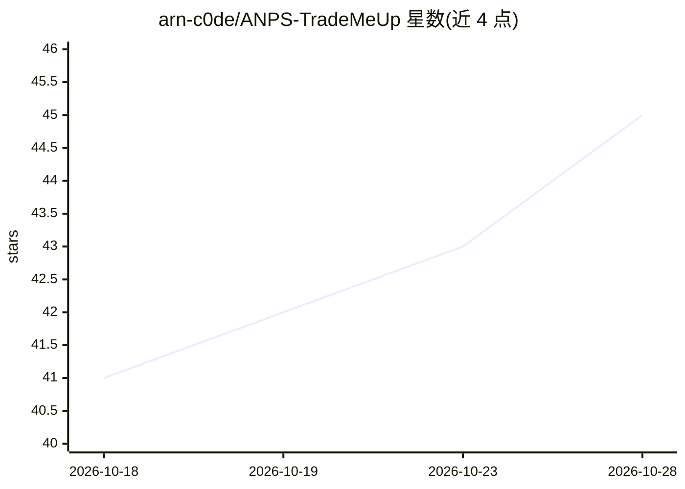

# arn-c0de/ANPS-TradeMeUp

⭐ 45 · Python · NOASSERTION · 推送 2026-08-05 · [GitHub](https://github.com/arn-c0de/ANPS-TradeMeUp) · 个人维护

**LLM 驱动的新闻-市场预测系统，含 Dash 仪表盘**

多 agent 的新闻到市场预测系统：摄取金融新闻，用 LLM 支持的分析抽取实体与事件，对冲击与意外程度打分，产出中短期市场预测；提供 Dash GUI、FastAPI 后端与 PostgreSQL 存储，通过 docker compose 编排 postgres/api/gui/worker 服务，另有可选的持续管道 worker、单次 MVP 管道与组合模拟入口。LLM 默认走 OpenAI（gpt-4o-mini），支持自定义 OpenAI 兼容代理端点。

## 筛选速览

| 维度 | 判定 | 备注 |
|---|---|---|
| AI 角色 | `ai-native` | 本体是模型或模型工具 |
| 许可风险 | `none` | NOASSERTION |
| 部署形态 | `self-host` | docker 或自建部署 |
| 模型依赖 | — | README 未给出锁定关系 |
| 硬件要求 | — | 无带数字的原话,不猜 |
| 安装摩擦 | `low` | 无编译、无系统依赖或容器化 |
| 成熟度 | — | 结构信号不足 |

## 能力要点

- LLM 抽取新闻实体与事件并评估冲击/意外程度
- 产出市场预测，提供 Dash 仪表盘（实时图表、新闻流、预测、交易模拟、统计）
- docker compose 全栈编排 postgres/api/gui/worker
- 支持 OpenAI 兼容代理，模型默认 gpt-4o-mini

## 适用场景

- 我想用 LLM 分析金融新闻并生成中短期市场预测
- 需要带可视化仪表盘和 API 的市场预测系统自行部署
- 做基于新闻事件的组合模拟与回测实验

## 场景标签

`金融量化` `多智能体` · 领域:Agent 开发

## 证据(README 行号)

> L3: ANPS-TradeMeUp is a multi-agent news-to-market prediction system. It ingests financial news, extracts entities and e
> L78: Set `OPENAI_API_KEY` in `.env.local`, then run:

## 星数曲线

2026-10-18 41 → 2026-10-28 45（+4）

---
*卡片 v1 · prompt 1.4 · 生成 2026-10-25 · 置信度 high · 依据 README sha `d822f847910b` · [字段定义](../../DATASET.md)*
