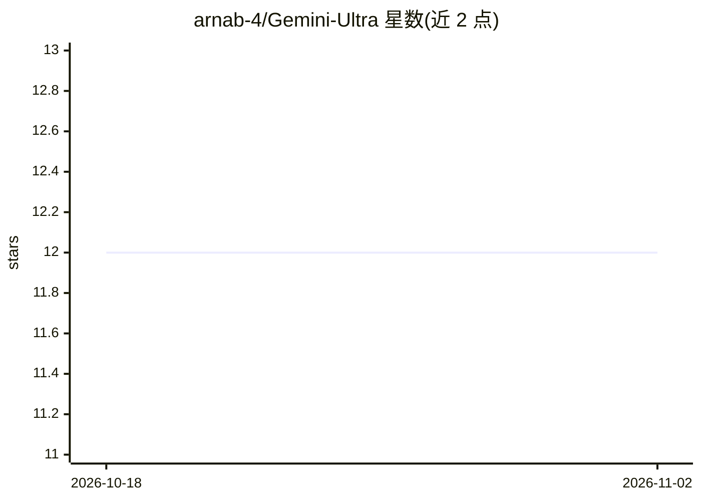

# arnab-4/Gemini-Ultra

⭐ 12 · TypeScript · MIT · 推送 2026-06-15 · [GitHub](https://github.com/arnab-4/Gemini-Ultra) · [官网](https://gemini-ultra-iota.vercel.app) · 个人维护 · 中文 README

**可一键部署的 Gemini 私有聊天应用，支持图像与语音**

基于 Next.js 的 Gemini API 聊天客户端：用户配置自己的 Gemini API Key 后可一键免费部署到 Vercel，或作为约 4MB 的跨平台（Windows/macOS/Linux）菜单栏客户端运行。支持多模态模型（图像、视频、音频与部分文本文档）、语音对话模式、图像识别、助手市场、Markdown/LaTeX 渲染与上下文自动压缩；数据存储在用户浏览器本地。提供访问密码与自定义模型列表等环境变量配置，支持 PWA 与静态部署。

## 筛选速览

| 维度 | 判定 | 备注 |
|---|---|---|
| AI 角色 | `ai-native` | 本体是模型或模型工具 |
| 许可风险 | `permissive` | MIT |
| 部署形态 | `self-host` | docker 或自建部署 |
| 模型依赖 | — | README 未给出锁定关系 |
| 硬件要求 | — | 无带数字的原话,不猜 |
| 安装摩擦 | `low` | 无编译、无系统依赖或容器化 |
| 成熟度 | — | 结构信号不足 |

## 能力要点

- 支持 Gemini 多模态模型（图像/视频/音频/文档理解）与语音对话模式
- Vercel 一键免费部署，约 4MB 跨平台菜单栏客户端
- 上下文自动压缩以延长对话并节省 token
- 数据本地存储于浏览器，支持 14 种语言界面

## 适用场景

- 部署一个仅自己使用的 Gemini 网页聊天应用
- 在桌面上以菜单栏常驻方式与 Gemini 对话或识别图片
- 通过环境变量控制访问密码与可用模型列表

## 场景标签

`聊天机器人` · 领域:对话与助手

## 证据(README 行号)

> L9: Deploy your private Gemini application for free with one click, supporting current Gemini API models such as Gemini 
> L25: - Supports multimodal models capable of understanding images, videos, audios, and some text documents.

## 星数曲线

2026-10-18 12 → 2026-11-02 12（+0）

---
*卡片 v1 · prompt 1.4 · 生成 2026-11-01 · 置信度 mid · 依据 README sha `2e226e9009b1` · [字段定义](../../DATASET.md)*
