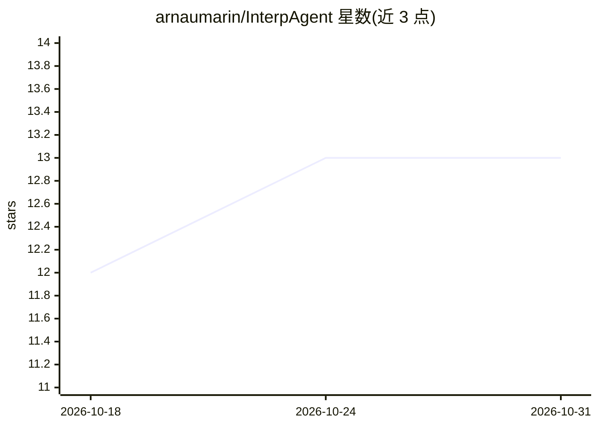

# arnaumarin/InterpAgent

⭐ 13 · Python · MIT · 推送 2026-10-29 · [GitHub](https://github.com/arnaumarin/InterpAgent) · [官网](https://arxiv.org/abs/2605.01555) · 个人维护

**用 AI Agent 自动化语言模型可解释性与特征发现的框架**

面向机制可解释性研究的 AI Agent 框架：通过可配置的 agent 工作区（workspace/config.yaml 定义 agent 图）自动执行稀疏自编码器（SAE）特征分析工作流。FeatureFinder 从 SAE codes 计算标记特征（Wilcoxon 检验、log2 fold change、Cohen's d），支持多种 LLM 后端（OpenAI、Anthropic、Google Gemini），读取 Gemma-2 MLP 输出上的 GemmaScope 字典，含多语言 prompt 集与 FLORES-200 平行语料构建脚本。通过 Streamlit 界面运行，需自备 API key。

## 筛选速览

| 维度 | 判定 | 备注 |
|---|---|---|
| AI 角色 | `ai-ecosystem` | LLM/agent 周边工具 |
| 许可风险 | `permissive` | MIT |
| 部署形态 | `library` | 以包/库形式分发 |
| 模型依赖 | — | README 未给出锁定关系 |
| 硬件要求 | — | 无带数字的原话,不猜 |
| 安装摩擦 | `low` | 无编译、无系统依赖或容器化 |
| 成熟度 | — | 结构信号不足 |

## 能力要点

- 可配置 agent 图的 workspace 与工具/子 agent 工作区
- FeatureFinder 对 SAE codes 做 Wilcoxon 检验、log2 fold change 与 Cohen's d 标记统计
- 支持 OpenAI / Anthropic / Google Gemini 多种 LLM 后端
- SAE 激活钩子兼容新旧 sae-lens API，支持半拆分复制验证

## 适用场景

- 自动化发现语言模型 SAE 特征并做统计验证
- 多语言（平行语料）条件下做特征对比实验
- 在浏览器界面中与 agent 协作完成可解释性分析

## 场景标签

`Agent 框架` `科研工具` · 领域:Agent 开发

## 证据(README 行号)

> L3: AI Agent framework for automated interpretability workflows, with support for multiple LLM backends (OpenAI, Anthrop
> L47: Both agents read SAE inputs from the Gemma-2 MLP output **after** `post_feedforward_layernorm`

## 星数曲线

2026-10-18 12 → 2026-10-31 13（+1）

---
*卡片 v1 · prompt 1.4 · 生成 2026-10-31 · 置信度 mid · 依据 README sha `c4797054a404` · [字段定义](../../DATASET.md)*
