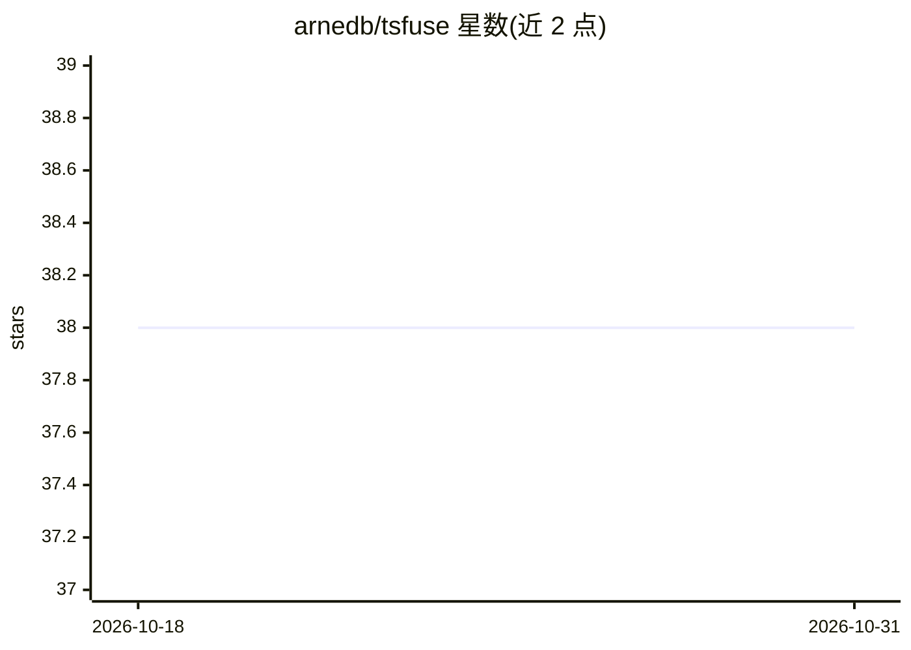

# arnedb/tsfuse

⭐ 38 · Python · NOASSERTION · 推送 2026-03-07 · [GitHub](https://github.com/arnedb/tsfuse) · [官网](https://arnedb.github.io/tsfuse/) · 个人维护

**多时间序列自动特征构造的 Python 库**

面向时序数据分析的 Python 包：输入由窗口化多时间序列（Collection 字典，含 id/time/data 列，支持多变量如三轴加速度）与逐窗口标签构成，construct 函数自动生成特征 DataFrame，并可返回包含全部转换步骤的计算图，通过 transform 应用于新数据。基于 pandas，配套在线文档，发表于 Machine Learning (2022) 的论文可引用。以 pip 安装的库形式提供，无独立客户端。

## 筛选速览

| 维度 | 判定 | 备注 |
|---|---|---|
| AI 角色 | `ai-native` | 本体是模型或模型工具 |
| 许可风险 | `none` | NOASSERTION |
| 部署形态 | `library` | 以包/库形式分发 |
| 模型依赖 | — | README 未给出锁定关系 |
| 硬件要求 | — | 无带数字的原话,不猜 |
| 安装摩擦 | `low` | 无编译、无系统依赖或容器化 |
| 成熟度 | — | 结构信号不足 |

## 能力要点

- construct 从多时间序列与标签自动构造特征
- 返回可复用的计算图（graph.transform 应用于新数据）
- 支持单变量与多变量时间序列（如三轴加速度）
- 配套在线文档与可引用论文

## 适用场景

- 从传感器多路时序数据自动生成机器学习特征
- 将构造好的特征流水线复用到新数据
- 科研场景中引用论文做时序特征工程

## 场景标签

`数据分析` · 领域:效率与自动化

## 证据(README 行号)

> L3:  Python package for automatically constructing features from multiple time series

## 星数曲线

2026-10-18 38 → 2026-10-31 38（+0）

---
*卡片 v1 · prompt 1.4 · 生成 2026-10-25 · 置信度 high · 依据 README sha `91a0e22258de` · [字段定义](../../DATASET.md)*
