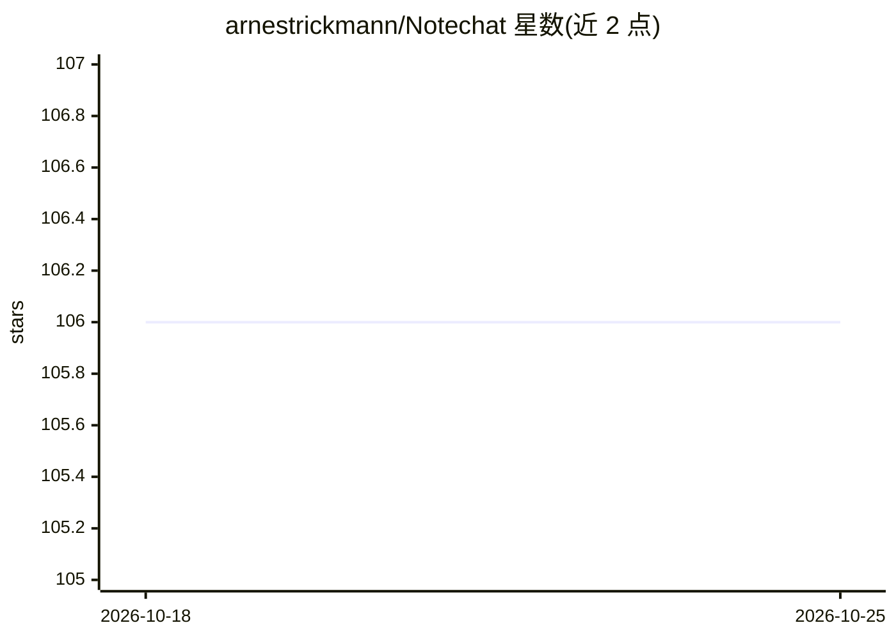

# arnestrickmann/Notechat

⭐ 106 · TypeScript · MIT · 推送 2025-12-17 · [GitHub](https://github.com/arnestrickmann/Notechat) · [官网](https://notechat.app) · 组织维护

**本地与 Apple Notes 对话聊天的桌面应用**

基于 Electron 与 React 构建的 macOS 桌面应用，通过聊天界面与用户的 Apple Notes 交互。数据层使用 SQLite（better-sqlite3）配合 sqlite-vec 扩展存储笔记与分块并执行向量相似度检索；通过 Electron IPC 与本地 Ollama 服务通信（如 checkOllamaStatus）获取模型状态。README 提供 npm install 源码运行方式与 DMG 打包应用的运行说明，并记录打包版 sqlite-vec 扩展加载与 Node 模块版本不匹配的修复方法。文档以开发指南为主，面向贡献者与开发者。

## 筛选速览

| 维度 | 判定 | 备注 |
|---|---|---|
| AI 角色 | `ai-native` | 本体是模型或模型工具 |
| 许可风险 | `permissive` | MIT |
| 部署形态 | `desktop` | 安装包/桌面程序 |
| 模型依赖 | local-ok | 支持本地模型 |
| 硬件要求 | — | 无带数字的原话,不猜 |
| 安装摩擦 | `low` | 无编译、无系统依赖或容器化 |
| 成熟度 | — | 结构信号不足 |

## 能力要点

- Electron + React 桌面应用，聊天界面操作 Apple Notes
- SQLite + sqlite-vec 向量相似度检索笔记分块
- 通过 IPC 检查本地 Ollama 服务状态
- 提供 DMG 打包版运行说明与开发文档

## 适用场景

- 用对话方式查询自己的 Apple 笔记内容
- 本地搭建笔记问答工具（配合 Ollama）
- 开发者参与贡献或自行打包构建应用

## 场景标签

`文档问答` `聊天机器人` · 领域:对话与助手

## 证据(README 行号)

> L6: Notechat is a desktop application that enables you to interact with your Apple Notes through a chat interface.
> L185: The `databaseService.ts` file defines a DatabaseService class that manages interactions with a SQLite database usi

## 星数曲线

2026-10-18 106 → 2026-10-25 106（+0）

---
*卡片 v1 · prompt 1.4 · 生成 2026-10-23 · 置信度 mid · 依据 README sha `ad8e09d8e45c` · [字段定义](../../DATASET.md)*
