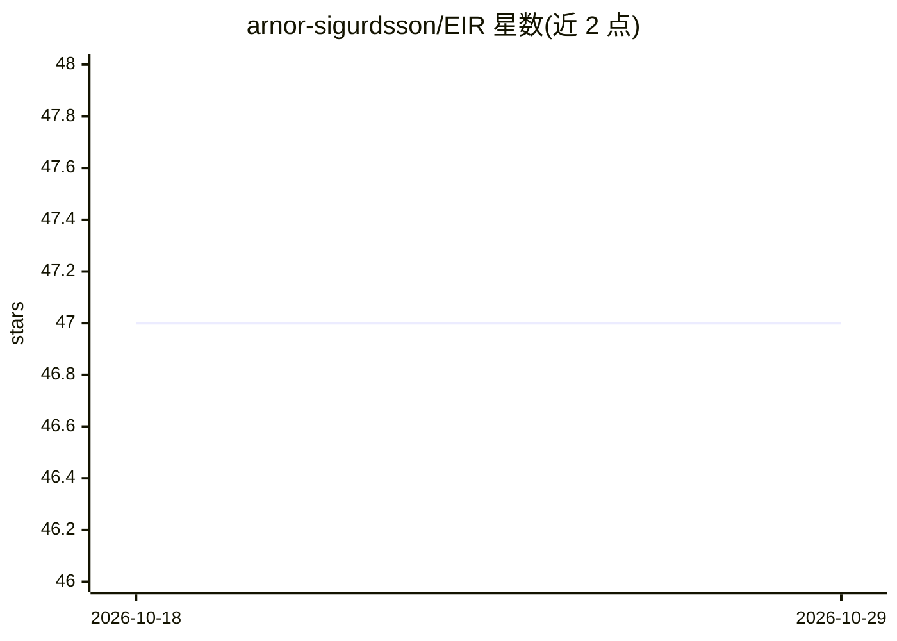

# arnor-sigurdsson/EIR

⭐ 47 · Python · AGPL-3.0 · 推送 2026-10-09 · [GitHub](https://github.com/arnor-sigurdsson/EIR) · [官网](https://eir.readthedocs.io/) · 个人维护

**多模态深度学习训练工具包，覆盖基因型到图像等多种数据**

面向命令行与 YAML 配置的深度学习训练框架：支持基因型、表格、序列、图像、数组和二进制数据的监督学习、序列/图像生成、时间序列与生存分析，可多模态组合训练，内置检查点、迁移与流式大数据训练。给需要在新数据集上快速建模或建立基线的研究者使用；README 声明处于 alpha 阶段，版本间 API 可能不兼容，最新版要求 Python 3.13。

## 筛选速览

| 维度 | 判定 | 备注 |
|---|---|---|
| AI 角色 | `ai-ecosystem` | LLM/agent 周边工具 |
| 许可风险 | `viral` | AGPL-3.0 |
| 部署形态 | `self-host` | docker 或自建部署 |
| 模型依赖 | — | README 未给出锁定关系 |
| 硬件要求 | — | 无带数字的原话,不猜 |
| 安装摩擦 | `low` | 无编译、无系统依赖或容器化 |
| 成熟度 | `idea` | |

## 能力要点

- 通过 YAML 配置文件从命令行直接训练模型
- 六种输入模态及多模态组合训练
- 支持流式数据训练与检查点/迁移学习
- 内置模型可解释性与训练期评估指标

## 适用场景

- 在新数据集上快速搭建并迭代深度学习模型
- 为自研模型建立对比基线
- 在大规模基因组等缺少现成 DL 实现的数据上建模

## 场景标签

`模型训练` · 领域:训练与推理

## 证据(README 行号)

> L19: Supervised modelling, sequence generation, image generation, array output and survival analysis on genotype, tabula
> L49: EIR allows for training and evaluating various deep-learning models directly from the command line. This can be use

## 星数曲线

2026-10-18 47 → 2026-10-29 47（+0）

---
*卡片 v1 · prompt 1.4 · 生成 2026-10-25 · 置信度 high · 依据 README sha `851f9bbabca2` · [字段定义](../../DATASET.md)*
