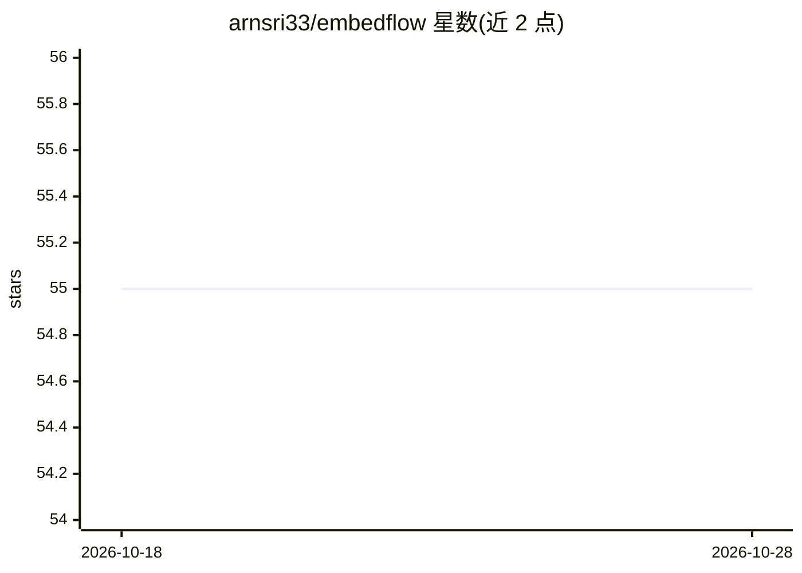

# arnsri33/embedflow

⭐ 55 · Python · AGPL-3.0 · 推送 2026-09-15 · [GitHub](https://github.com/arnsri33/embedflow) · 个人维护

**嵌入模型迁移工具：换模型时渐进物化目标向量、零停机**

面向已有向量索引的 embedding 模型升级工具：让新模型先在旧索引的候选集上提供检索服务，同时后台渐进物化目标文档向量，避免全量重建索引的停机窗口。提供迁移分析（T2-v1 有限尾部诊断给出 SAFE/EXPAND/UNSAFE 判定）、规划、影子模式观测、按热度预热、持久化缓存与结果注册表。以 PyPI 包、CLI、FastAPI 服务与 Python API 形式提供，支持 FAISS/Qdrant/pgvector/Pinecone/Milvus/Weaviate 后端。v0.8.0 为 pre-1.0 版本，SAFE 判定为经验信号而非检索质量保证。

## 筛选速览

| 维度 | 判定 | 备注 |
|---|---|---|
| AI 角色 | `ai-ecosystem` | LLM/agent 周边工具 |
| 许可风险 | `viral` | AGPL-3.0 |
| 部署形态 | `library` | 以包/库形式分发 |
| 模型依赖 | — | README 未给出锁定关系 |
| 硬件要求 | `cpu-ok` | |
| 安装摩擦 | `medium` | 含编译或系统依赖之一 |
| 成熟度 | `idea` | |

## 能力要点

- 渐进式嵌入迁移：新模型先服务、目标向量后台物化
- T2-v1 迁移分析输出 SAFE/EXPAND/UNSAFE_OR_UNCERTAIN 诊断
- 影子模式、预热计划与持久化缓存
- 版本化研究结果注册表（BRIGHT/NQ 评测记录）

## 适用场景

- 嵌入模型升级期间不重建全量索引保持检索可用
- 升级前分析旧索引候选集能否支撑新模型检索
- 用影子模式在真实流量上观测迁移效果

## 场景标签

`向量数据库` `语义搜索` `模型评测` · 领域:评测与运维

## 证据(README 行号)

> L7: EmbedFlow lets a new embedding model serve over candidates from an existing
> L10: through FAISS, Qdrant, pgvector, Pinecone, Milvus, Weaviate, a CLI, and FastAPI.
> L232: |FAISS|Supported|

## 星数曲线

2026-10-18 55 → 2026-10-28 55（+0）

---
*卡片 v1 · prompt 1.4 · 生成 2026-10-24 · 置信度 high · 依据 README sha `482922c5d189` · [字段定义](../../DATASET.md)*
