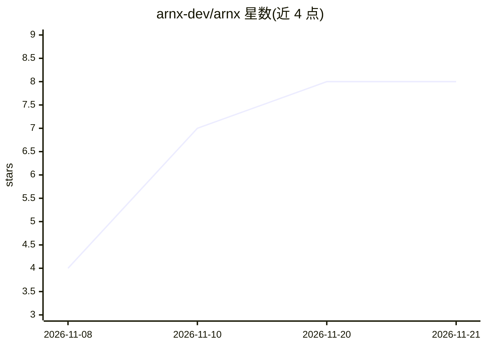

# arnx-dev/arnx

⭐ 8 · TypeScript · Apache-2.0 · 推送 2026-11-18 · [GitHub](https://github.com/arnx-dev/arnx) · [官网](https://arnx.dev) · 组织维护

**为编码 agent 的改动生成失败测试并给出可执行证据的工具**

arnx 面向使用编码 agent 的开发者：读取改动 diff，让模型列出改动可能破坏的行为，将每个疑点转成真实测试，在 Docker 中分别在改动前后两个版本的代码上运行，仅三次运行都失败且经第二意见复核的测试才成为 finding。支持 arnx triage/accept/check 工作流，接受后的测试保留在 .arnx/tests/ 持续守护行为。限制包括：单包 Python/TypeScript 仓库效果最佳，不运行浏览器测试，单次 review 上限 200 KB 改动。

## 筛选速览

| 维度 | 判定 | 备注 |
|---|---|---|
| AI 角色 | `ai-native` | 本体是模型或模型工具 |
| 许可风险 | `permissive` | Apache-2.0 |
| 部署形态 | `self-host` | docker 或自建部署 |
| 模型依赖 | locked-api |  |
| 硬件要求 | — | 无带数字的原话,不猜 |
| 安装摩擦 | `low` | 无编译、无系统依赖或容器化 |
| 成熟度 | `idea` | |

## 能力要点

- 疑点→测试→改动前后对照运行的验证流程，无失败测试即无 finding
- 三次重复运行加第二意见模型复核，disputed 结果保留标注
- accept 后测试持续留存，arnx check 无模型参与即可回归
- 测试运行于无网络、无主机环境的 Docker 一次性副本

## 适用场景

- 验证 coding agent 提交的改动是否引入回归
- 为改动自动生成并沉淀守护性测试
- 在 CI 前用 arnx check 快速复跑已接受的测试

## 场景标签

`代码审查` · 领域:编码与开发

## 证据(README 行号)

> L3: Your coding agent says the change is done. arnx tests whether it is.
> L5: arnx asks models what your change could have broken, turns each suspicion into a real test, and
> L6: runs it in Docker on your code with the change and without it. Every finding is a test that failed.

## 星数曲线

2026-11-08 4 → 2026-11-21 8（+4）

---
*卡片 v1 · prompt 1.4 · 生成 2026-11-20 · 置信度 high · 依据 README sha `2d180cd7fabe` · [字段定义](../../DATASET.md)*
