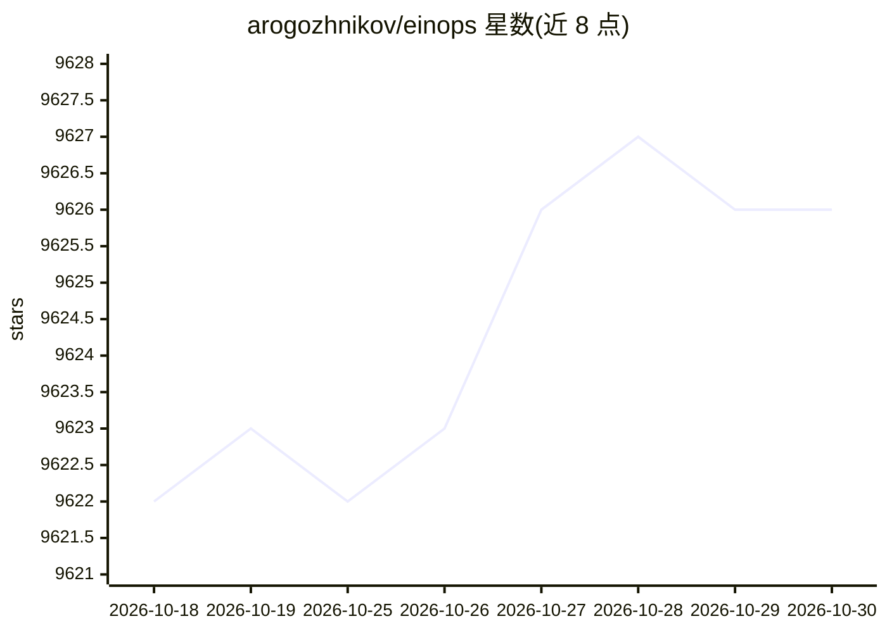

# arogozhnikov/einops

⭐ 9,626 · Python · MIT · 推送 2026-08-26 · [GitHub](https://github.com/arogozhnikov/einops) · [官网](https://einops.rocks) · 个人维护

**跨深度学习框架的张量操作库，用爱因斯坦式记号重排张量**

面向深度学习开发者的 Python 张量操作库：提供 rearrange/reduce/repeat、pack/unpack、einsum 与 EinMix 层，用统一记号在 numpy、pytorch、tensorflow、jax、cupy 等框架间以一致语义操作张量，并为各框架提供对应网络层。支持 torch.compile 与 Python array API 标准（含 MLX、dask 等）。pip 安装，要求 Python 3.10+；有 ICLR 2022 论文。

## 筛选速览

| 维度 | 判定 | 备注 |
|---|---|---|
| AI 角色 | `ai-ecosystem` | LLM/agent 周边工具 |
| 许可风险 | `permissive` | MIT |
| 部署形态 | `library` | 以包/库形式分发 |
| 模型依赖 | — | README 未给出锁定关系 |
| 硬件要求 | — | 无带数字的原话,不猜 |
| 安装摩擦 | `low` | 无编译、无系统依赖或容器化 |
| 成熟度 | — | 结构信号不足 |

## 能力要点

- rearrange/reduce/repeat 三核心操作覆盖堆叠、变形、转置、池化等
- pack/unpack 可逆打包多个不同维度的张量
- 同一代码在 numpy/pytorch/tf/jax/cupy 等框架行为一致
- 为 pytorch/tensorflow/flax/paddle 等提供对应网络层，支持 torch.compile

## 适用场景

- 在 PyTorch/JAX 等框架中用统一记号重排、降维张量，减少 shape 错误
- 让同一段张量操作代码在多个框架间复用
- 实现 MLP Mixer 等需要 EinMix 通用线性层的结构

## 场景标签

 · 领域:深度学习/科学计算库

## 证据(README 行号)

> L9: Flexible and powerful tensor operations for readable and reliable code.
> L10: Supports numpy, pytorch, jax, mlx and others.
> L239: ## Supported frameworks

## 星数曲线

2026-10-18 9,622 → 2026-10-30 9,626（+4）

---
*卡片 v1 · prompt 1.4 · 生成 2026-10-20 · 置信度 high · 依据 README sha `a64cbc05f09a` · [字段定义](../../DATASET.md)*
