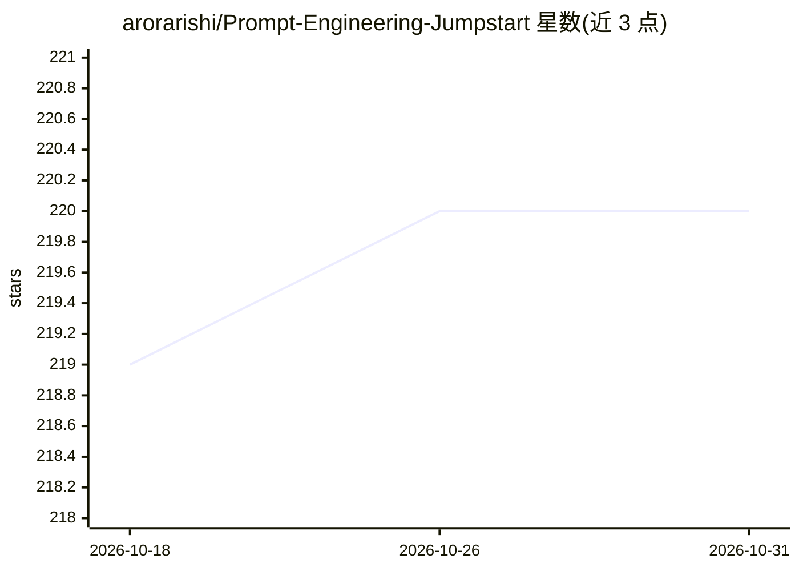

# arorarishi/Prompt-Engineering-Jumpstart

⭐ 220 · MIT · 推送 2025-12-23 · [GitHub](https://github.com/arorarishi/Prompt-Engineering-Jumpstart) · 个人维护

**面向初学者的提示工程开源电子书（14 章）**

一本 MIT 许可的开源电子书，讲解提示工程的通用模式：清晰指令、少样本示例、思维链、格式控制、迭代追问、负面提示、任务链等 14 章。每章含解释、实例、练习提示词与'前后对比'改造。面向 ChatGPT/Claude 等模型的零基础用户（学生、营销、写作者等），无需编程或数学。仓库状态为'Writing'（截至 2025 年 11 月写作冲刺），14 章已标完成，路线图计划补充 50+ 提示词与 PDF 版本。

## 筛选速览

| 维度 | 判定 | 备注 |
|---|---|---|
| AI 角色 | `ai-knowledge` | 知识聚合/清单类 |
| 许可风险 | `permissive` | MIT |
| 部署形态 | `None` |  |
| 模型依赖 | — | README 未给出锁定关系 |
| 硬件要求 | — | 无带数字的原话,不猜 |
| 安装摩擦 | `low` | 无编译、无系统依赖或容器化 |
| 成熟度 | `idea` | |

## 能力要点

- 14 个提示工程核心模式，每章带实例与练习提示词
- 无需技术背景，提供可复制粘贴的提示词与前后对比
- MIT 许可，内容可分享与再创作（需署名）
- 覆盖文本与图像（DALL-E）提示词章节

## 适用场景

- 零基础学习 ChatGPT/Claude 的提示词写法
- 工作中需要稳定 AI 输出的非技术从业者自学
- 查找常用提示模式速查表（Cheat Sheet）

## 场景标签

`提示工程` `教程课程` · 领域:Agent 开发

## 证据(README 行号)

> L29: **A fully open-source, hands-on guide** for absolute beginners.
> L33: You’ll learn the 14 core patterns used by experts — explained in the simplest way possible.

## 星数曲线

2026-10-18 219 → 2026-10-31 220（+1）

---
*卡片 v1 · prompt 1.4 · 生成 2026-10-22 · 置信度 high · 依据 README sha `588887868430` · [字段定义](../../DATASET.md)*
