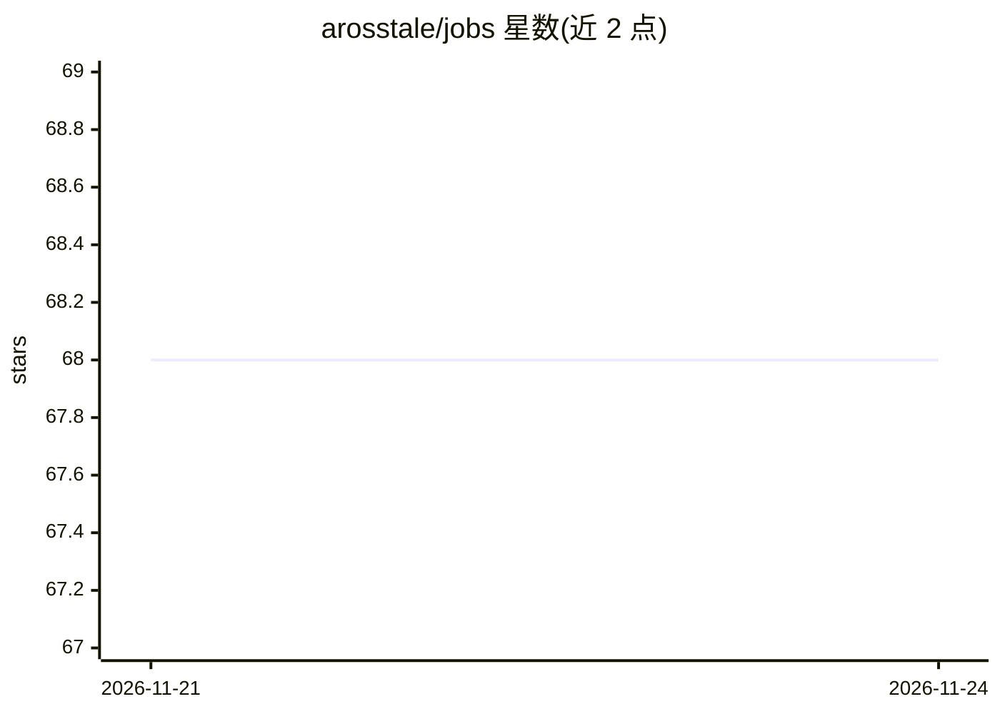

# arosstale/jobs

⭐ 68 · HTML · 推送 2026-03-17 · [GitHub](https://github.com/arosstale/jobs) · [官网](https://arosstale.github.io/jobs/) · 个人维护

**用 BLS 数据与 LLM 评估美国 342 种职业的 AI 暴露度可视化**

数据驱动的分析项目：用 Playwright 抓取美国劳工统计局（BLS）342 个职业页面，BeautifulSoup 转为 Markdown，再由 Gemini Flash 为每个职业打 0-10 分的 AI 暴露度评分并附理由，最后以 D3 treemap 呈现（面积=就业人数，颜色=暴露度）。提供在线演示与 occupations.csv、scores.json 等数据文件，用户可通过 uv 配置 OpenRouter API key 自行复现整条流水线。MIT 许可。

## 筛选速览

| 维度 | 判定 | 备注 |
|---|---|---|
| AI 角色 | `ai-native` | 本体是模型或模型工具 |
| 许可风险 | `none` | — |
| 部署形态 | `None` |  |
| 模型依赖 | locked-api |  |
| 硬件要求 | — | 无带数字的原话,不猜 |
| 安装摩擦 | `low` | 无编译、无系统依赖或容器化 |
| 成熟度 | — | 结构信号不足 |

## 能力要点

- Playwright 抓取 BLS 342 个职业页面，BeautifulSoup 转 Markdown
- Gemini Flash 为每个职业打 AI 暴露度分数（0-10）并附理由
- D3 treemap 可视化：面积=就业人数，颜色=暴露度
- 开放 occupations.csv / scores.json / data.json 数据文件

## 适用场景

- 查看某个职业的 AI 暴露度评分与理由
- 研究哪些职业受 AI 与自动化影响程度高低
- 下载 CSV/JSON 数据做自己的职业风险分析

## 场景标签

 · 领域:数据可视化/劳动经济分析

## 证据(README 行号)

> L25: Scrape BLS → Parse to Markdown → Score with LLM → Build treemap
> L30: 3. **Score** — Gemini Flash scores each occupation's AI exposure (0-10) with rationale
> L31: 4. **Visualize** — D3 treemap where area = jobs and color = exposure

## 星数曲线

2026-11-21 68 → 2026-11-24 68（+0）

---
*卡片 v1 · prompt 1.4 · 生成 2026-11-21 · 置信度 high · 依据 README sha `a5a944b0a259` · [字段定义](../../DATASET.md)*
