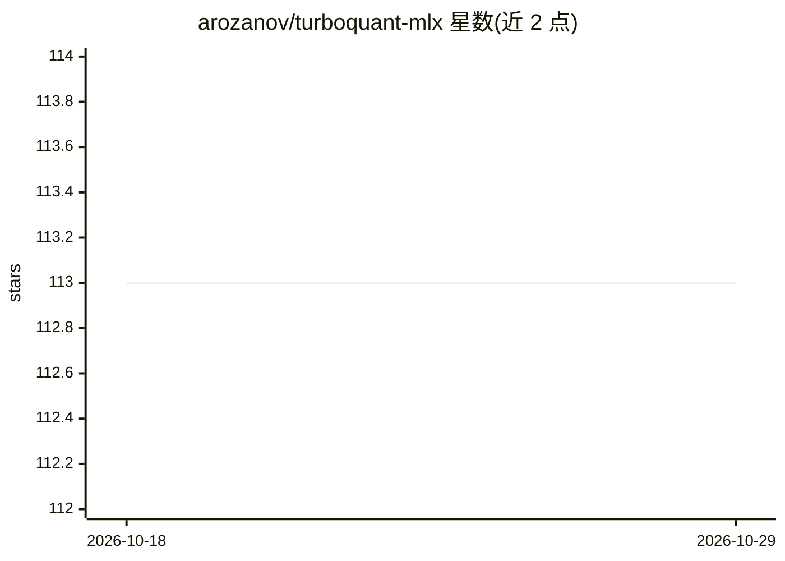

# arozanov/turboquant-mlx

⭐ 113 · Python · 推送 2026-04-30 · [GitHub](https://github.com/arozanov/turboquant-mlx) · 个人维护

**MLX 上的 KV cache 压缩库：Metal 融合内核降低长上下文显存**

面向 Apple Silicon MLX 生态的 KV cache 量化压缩库：以 PolarQuant（随机 Hadamard 旋转 + Lloyd-Max 量化）将 V 值压缩至 3-bit，含混合精度方案（K 8-bit + V 4-bit，依赖 mlx-lm fork）与免 fork 的 V-only 方案。实现融合 Metal 内核（Q 打分、稀疏 V 注意力、SIMD 归约），并给 mlx_lm.server 增加 KV 量化、磁盘持久化与 MoE 支持的服务端标志。Qwen 2.5 7B 32K 上下文下内存节省约 18-20%，贪心解码结果与基线一致，解码速度有所下降。

## 筛选速览

| 维度 | 判定 | 备注 |
|---|---|---|
| AI 角色 | `ai-ecosystem` | LLM/agent 周边工具 |
| 许可风险 | `none` | — |
| 部署形态 | `library` | 以包/库形式分发 |
| 模型依赖 | — | README 未给出锁定关系 |
| 硬件要求 | — | 无带数字的原话,不猜 |
| 安装摩擦 | `low` | 无编译、无系统依赖或容器化 |
| 成熟度 | — | 结构信号不足 |

## 能力要点

- PolarQuant 3-bit V 压缩与 K8+V4 混合精度两种方案
- 融合 Metal 内核：预旋转 Q 打分、稀疏 V 注意力、SIMD 归约
- mlx_lm.server 集成：KV 量化标志、prompt cache 磁盘持久化、MoE 支持
- 51 个测试，贪心解码质量验证与基线一致

## 适用场景

- 长上下文推理时降低 Apple Silicon 上的 KV cache 内存占用
- mlx-lm 部署中启用 KV 量化与 prompt cache 磁盘持久化
- 验证不同 K/V 位宽组合下的内存-质量权衡

## 场景标签

`模型量化` · 领域:训练与推理

## 证据(README 行号)

> L3: TurboQuant KV cache compression for MLX on Apple Silicon.
> L5: PolarQuant (randomized Hadamard rotation + Lloyd-Max quantization) compresses KV cache values to 3-bit with fused Me

## 星数曲线

2026-10-18 113 → 2026-10-29 113（+0）

---
*卡片 v1 · prompt 1.4 · 生成 2026-10-23 · 置信度 mid · 依据 README sha `511951e2f19b` · [字段定义](../../DATASET.md)*
