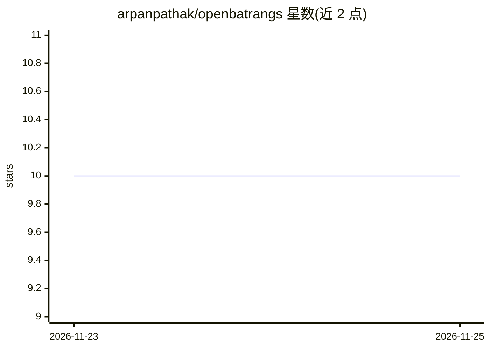

# arpanpathak/openbatrangs

⭐ 10 · Rust · AGPL-3.0 · 推送 2026-11-18 · [GitHub](https://github.com/arpanpathak/openbatrangs) · 个人维护

**终端编码 agent：接本地模型在自有硬件上写代码**

Rust 编写的终端编码 agent，通过 OpenAI 兼容 API 或专属 Ollama 通道连接本地/云 GPU 上的开源模型，执行文件读写、shell 命令、代码搜索与网页搜索等工具调用，提供 agent/plan/chat 三种模式与逐步确认、沙箱隔离等安全机制。以二进制、crates.io 或源码方式分发，支持 Linux 与 macOS，也提供 Google Colab notebook。模型服务由用户自行部署，代码保留在用户控制的机器上。

## 筛选速览

| 维度 | 判定 | 备注 |
|---|---|---|
| AI 角色 | `ai-ecosystem` | LLM/agent 周边工具 |
| 许可风险 | `viral` | AGPL-3.0 |
| 部署形态 | `library` | 以包/库形式分发 |
| 模型依赖 | local-ok | 支持本地模型 |
| 硬件要求 | — | 无带数字的原话,不猜 |
| 安装摩擦 | `low` | 无编译、无系统依赖或容器化 |
| 成熟度 | — | 结构信号不足 |

## 能力要点

- 支持 TensorRT Edge-LLM、TensorRT-LLM、vLLM、SGLang、llama.cpp、Ollama 及任意 OpenAI 兼容服务器
- 每步写文件与执行命令前需确认，命令在 bubblewrap/sandbox-exec 沙箱中运行
- 提供 --read-only 模式与删除类命令的强制确认
- 实时显示模型服务器的 GPU 利用率、显存与 KV-cache 等指标

## 适用场景

- 不想订阅付费编码助手，在自有 GPU 上跑开源模型完成编码任务
- 在 GPU 云虚拟机上部署模型、本地笔记本通过 SSH 转发连接使用
- 在 Colab 免费 GPU 上试用编码 agent

## 场景标签

`编码 Agent` · 领域:编码与开发

## 证据(README 行号)

> L5: A terminal coding agent for local language models, on any hardware.
> L28: - **Engines:** TensorRT Edge-LLM, TensorRT-LLM, vLLM, SGLang, llama.cpp, Ollama,
> L126: Start a model server on your GPU machine, then point openbatrangs at it from

## 星数曲线

2026-11-23 10 → 2026-11-25 10（+0）

---
*卡片 v1 · prompt 1.4 · 生成 2026-11-23 · 置信度 high · 依据 README sha `4ec01bc4fe20` · [字段定义](../../DATASET.md)*
