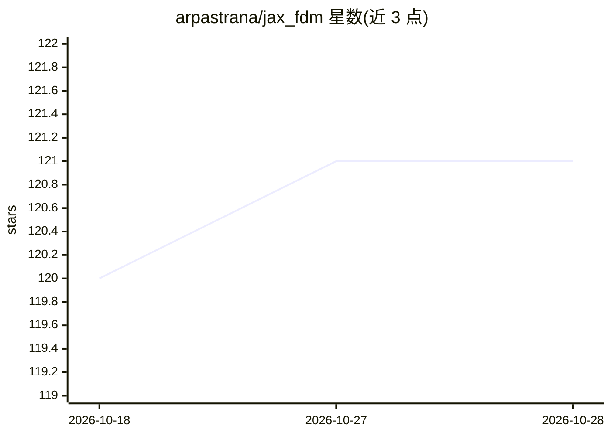

# arpastrana/jax_fdm

⭐ 121 · Python · MIT · 推送 2026-09-11 · [GitHub](https://github.com/arpastrana/jax_fdm) · [官网](https://arpastrana.github.io/jax_fdm) · 组织维护

**面向轻量结构找形的可微力密度法库（JAX）**

基于 JAX 实现的力密度法（FDM）结构求解库：计算铰接杆件体系的静力平衡态，支持自动微分、JIT 编译与 CPU/GPU/TPU 并行；将找形问题表述为逆设计问题，用梯度优化器自动调整力密度、荷载与支座位置以满足目标与约束，提供目标/约束/损失函数的面向对象 API。力学仿真可作为神经网络中的一层参与端到端训练。依赖 COMPAS 2.x、JAX、SciPy、Equinox，支持 Python 3.11-3.13，由普林斯顿大学团队以 MIT 许可发布，自述为开发中的研究项目、API 可能变更。

## 筛选速览

| 维度 | 判定 | 备注 |
|---|---|---|
| AI 角色 | `ai-ecosystem` | LLM/agent 周边工具 |
| 许可风险 | `permissive` | MIT |
| 部署形态 | `library` | 以包/库形式分发 |
| 模型依赖 | — | README 未给出锁定关系 |
| 硬件要求 | — | 无带数字的原话,不猜 |
| 安装摩擦 | `low` | 无编译、无系统依赖或容器化 |
| 成熟度 | `idea` | |

## 能力要点

- 力密度法求解铰接杆件体系静力平衡
- 自动微分 + JIT + CPU/GPU/TPU 并行
- 梯度优化器自动调整力密度、荷载与支座位置
- 结构仿真可作为神经网络层参与端到端训练

## 适用场景

- 张拉索网等轻量结构的约束找形设计
- 把结构静力仿真嵌入深度学习模型做逆设计研究
- 按目标力/目标长度等约束优化可建造结构形态

## 场景标签

 · 领域:结构工程/可微计算

## 证据(README 行号)

> L23: JAX FDM solves inverse design problems for lightweight structures modeled as pin-jointed bar systems using the forc
> L43: As an auto-differentiable library, JAX FDM can be seamlessly added as a layer in a differentiable function approxim

## 星数曲线

2026-10-18 120 → 2026-10-28 121（+1）

---
*卡片 v1 · prompt 1.4 · 生成 2026-10-23 · 置信度 high · 依据 README sha `449419a24f0f` · [字段定义](../../DATASET.md)*
