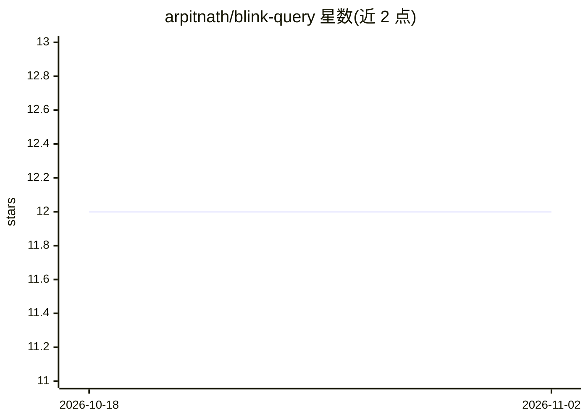

# arpitnath/blink-query

⭐ 12 · TypeScript · MIT · 推送 2026-04-12 · [GitHub](https://github.com/arpitnath/blink-query) · [官网](https://www.npmjs.com/package/blink-query) · 个人维护

**给 LLM agent 的本地 markdown 知识解析库与 MCP 服务器**

面向 LLM agent 的知识解析库：markdown 文件保留在磁盘上可编辑，库在其旁建立 SQLite 索引，提供 5 种类型化记录（SUMMARY/META/SOURCE/ALIAS/COLLECTION）、基于 FTS5 的标题加权 BM25 搜索、确定性路径解析、Peggy 查询 DSL，以及带 11 个工具的 MCP 服务器，可接入 Claude Desktop/Code、Cursor、Codex。无云、无嵌入向量、无守护进程。支持 markdown 目录、PostgreSQL、GitHub Issues、git 仓库与 URL 多源摄取。以 npm 库与 CLI 形式提供，MIT 许可。

## 筛选速览

| 维度 | 判定 | 备注 |
|---|---|---|
| AI 角色 | `ai-ecosystem` | LLM/agent 周边工具 |
| 许可风险 | `permissive` | MIT |
| 部署形态 | `library` | 以包/库形式分发 |
| 模型依赖 | — | README 未给出锁定关系 |
| 硬件要求 | — | 无带数字的原话,不猜 |
| 安装摩擦 | `low` | 无编译、无系统依赖或容器化 |
| 成熟度 | — | 结构信号不足 |

## 能力要点

- 5 种类型化记录，每种携带 agent 消费指令
- 标题加权 BM25/FTS5 搜索，无嵌入向量与云端依赖
- MCP 服务器 11 个工具，agent 可在运行时读写记录与创建 zone
- markdown/PostgreSQL/git/GitHub Issues/URL 多源摄取

## 适用场景

- 为我的 agent 挂载一个可读写的本地知识库
- 把 markdown 笔记目录变成可查询的类型化 wiki
- 在不引入向量库的前提下给 agent 提供检索工具

## 场景标签

`知识库管理` · 领域:知识与检索

## 证据(README 行号)

> L11: blink-query is a knowledge resolution library for LLM agents. Markdown files stay on disk where you can read and ed
> L20: - **MCP server with 11 tools** — drop-in for Claude Desktop, Claude Code, Cursor, Codex

## 星数曲线

2026-10-18 12 → 2026-11-02 12（+0）

---
*卡片 v1 · prompt 1.4 · 生成 2026-11-01 · 置信度 high · 依据 README sha `7ba02d837c8d` · [字段定义](../../DATASET.md)*
